# DFX Prayer Intentions User Manual

Versión en español: [Manual de DFX Prayer Intentions](../es/README.md)

Version 1.0.2611203 · November 2026

This manual is also in the panel itself, under "Prayer intentions › Manual", with its screenshots.

## What it is and who it is for

DFX Prayer Intentions helps the leaders of a prayer group keep track of the intentions they receive, decide how each person is named, and share a message with the group every day. This manual covers version 1.0.2611203 of the WordPress plugin and of its app for phones.

The screenshots in this manual come from a test site with made-up data.

Intentions arrive by word of mouth, in a message or on a piece of paper. Some are for tomorrow's operation, some for someone who died last week, some for an illness that lasts for months. The plugin gives each group a private panel for that work, and everyone else a single thing: a form to ask for prayer.

### The pieces

| Piece | Who uses it | What for |
| --- | --- | --- |
| Request form | Anyone who has the address | Asking for prayer, choosing how their name may appear |
| Group panel (WordPress dashboard) | The leaders of each group (administrators too, only in the groups they lead) | Moderating, keeping track of intentions, preparing the message and the digest |
| Leaders' app (PWA) | Leaders, on their phones | The same as the panel, in their pocket and offline |
| Daily digest and alerts | Leaders, by email, Telegram or webhook | Knowing every day what is going on, and praying at the time of each event |
| Routines | A program of the leader's own | Keeping the list up to date automatically |

### Basic concepts

- **Group**: a prayer group, with its leaders, its form, its message and its settings. A site can have several independent groups; with only one, the plugin behaves as if groups did not exist.
- **Intention**: a prayer request. It has a full text, which is never published, and a short summary written by a leader, which is the only thing the group sees.
- **Kind**: a moment in particular, a death, a situation that goes on, or a thanksgiving. The kind decides how long the intention stays on the list.
- **Discretion**: how the name may appear (full name, first name, initials or anonymous). The person who asks chooses it, and leaders can only make it stricter.
- **Message for the group**: the list of current intentions, ready to paste into WhatsApp. The plugin writes it; nobody types it by hand.

None of this is published on the website: intentions live in the plugin's own tables, away from posts, search engines, feeds and sitemaps.

## Installation and first steps

The plugin needs WordPress 6.5 or later and PHP 8.1 or later, and it does not depend on any external service. It is installed like any other plugin, uploading the zip from *Plugins › Add New Plugin*.

When it is activated, it creates its tables, the "Prayer leader" role and two scheduled tasks: one every five minutes (reviews, hour alerts, digest) and one daily (deleting old data).

### The administrator's first steps

1. Give the "Prayer leader" role to the people who will lead a group.
2. In "Prayer intentions › Groups", create the group and tick its leaders. If you are going to lead it as well, tick yourself: an administrator only sees the intentions of the groups they lead.
3. Fill in the "Data protection" details of that same group (see *Data protection*).
4. Share the address of the form, which appears in the group's card and in "Group settings".
5. Set up a real cron job on the server that calls `wp-cron.php` every five minutes. Without it, WordPress only runs its tasks when someone visits the site, and the digest and the alerts may arrive late.

### The menu

- **"Prayer intentions"**, with a bubble that counts the pending requests of your groups.
- **"Groups"**: for administrators it opens with the **"Statistics of all groups"**, a table with one row per group (archived ones too) and the "All groups" total. Figures only: "Leaders", "Members" (living), "Pending", "In the list" (active and in review), "Received" and "Closed" in the last 30 days, "Answered" since the beginning and "Total received". It shows no names or texts, and a group's name only leads to its intentions if the administrator leads it. Below, for everyone, one card for each group you lead, with its counters ("Pending", "In review", "Events today", "Events tomorrow") and the "Daily digest" and "Add intention" buttons.
- **"Global settings"**, for administrators only.
- **One entry for each group you lead**, with its own bubble of pending requests. This applies to administrators too: the groups they do not lead only appear in "Manage groups".

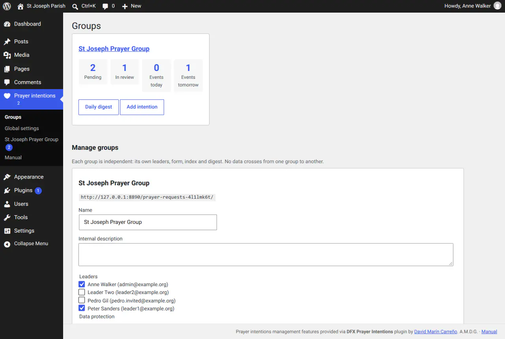

### Notices when you open a group

- **Confidentiality.** It reminds leaders of their duty of discretion about illnesses, deaths and family situations. It goes away when you press "Understood", once per person.
- **Data protection.** It appears while the group has no data controller, or the date of the data processing agreement is missing.

> Careful when uninstalling: the option "Delete all data when the plugin is uninstalled" comes switched on. If you only want to stop using the plugin for a while, deactivate it; do not delete it.

## Groups, leaders and permissions

Each group is independent: its leaders, its form, its message and its digest. No data passes from one group to another, and a leader only sees the groups assigned to them.

### Who can do what

| Person | Sees | Can |
| --- | --- | --- |
| Administrator | The active groups they lead, like any leader; the rest only in "Manage groups" (name, leaders, data protection) and in the statistics (figures only), without their intentions | Create, edit, archive and delete any group; assign, invite and remove leaders; global settings; personal data requests of any group; mark service accounts |
| Prayer leader | Only their groups | Everything inside them: moderation, intentions, digests, members, "Group settings" (channels, time limits, new form address) and inviting new leaders |
| Other roles with access to the panel | Only the groups assigned to them | The same as a leader |

The "Prayer leader" role only gives access to the panel and to one's own profile. Someone who only has access to the panel goes straight into their group when they log in, without going through the WordPress dashboard. In "Global settings › Access to the panel" the administrator can give access to other roles.

### Creating and editing a group

In "Groups › Manage groups" (administrators only) each group has a card with:

- **"Name"** (required) and **"Internal description"**.
- **"Leaders"**: a checkbox for each user with access to the panel. Service accounts carry "· service account".
- **"Data protection"**: data controller, contact, its own privacy policy, and the date the data processing agreement was accepted.
- **"Data processing agreement of this group"**: the text of the contract (Article 28 of the GDPR), ready to copy.

The "New group" card, at the end, creates a new one.

### Inviting a leader

Any leader of a group can invite someone else to lead it, without going through the administrator. It is done in "Group settings › Leaders":

1. At the top you see the list of the group's leaders (only their names; administrators also see their email) and the "Pending invitations", each with its expiry date.
2. In "Invite a leader", type the person's "Name" and "Email" and press "Send invitation". The panel answers "Invitation sent."; if that person was already a leader of the group, nothing changes.
3. The person receives an email, "Invitation to lead…", which reminds them that leaders see very sensitive information and must keep it confidential, with a link to accept. **The link expires after 7 days.** If the same email is invited again, a new link is sent and the previous one stops working.
4. Opening the link shows the invitation and the "Accept the invitation" button. Opening the link accepts nothing: the button has to be pressed.
5. If they have no account on the site, the invitation itself tells them they will log in with their email and asks them to choose their password ("Password" and "Repeat the password", at least 8 characters); pressing "Accept and enter" creates the account with the "Prayer leader" role, makes them a leader of the group and takes them straight into it, already logged in. They also get a welcome email that tells them how to come back: their user is their email, the address to log in, the leaders' app and where to choose a new password if they forget it. If they already had an account, they press "Accept the invitation" and log in with it.

Anyone who does not remember their password can choose another on the login screen, with "Lost your password?" and their email.

The site administrator receives an email every time someone accepts, and the sending, withdrawal and acceptance are recorded in "Activity". While an invitation is pending, any leader of the group can press "Withdraw" and the link stops working. Expired invitations are deleted automatically, and accepted ones after a week.

Administrators can also invite to **any group**, including one they do not lead or that has no leaders yet: in "Groups › Manage groups", each group's card has its own "Invite a leader" block (with "Name", "Email" and "Send invitation") and the list of its "Pending invitations", each with "Withdraw". The invitation works the same way, and the email says that the administrator is inviting. The "New group" card does not have it: the group has to be created first.

**Only administrators remove leaders**, in "Groups › Manage groups", where they can also directly mark any user with access to the panel as a leader.

### The form's secret address

Each group has an address of its own with a random part, for example `/prayer-requests-7f3k9q2x/`. It does not appear in menus, search engines or sitemaps: only those who receive it know it.

If the address has spread where it should not, "Generate a new address" in "Group settings" creates another one. The previous one stops working at that moment.

### Archiving and deleting

- **"Archive"** takes the group out of the menus and switches its form off, but keeps the data. "Restore" brings it back.
- **"Delete group and all its intentions"** deletes everything: intentions, updates, comments, history and members. It cannot be undone.

With a single active group, the plugin behaves as if groups did not exist: leaders go straight into it and the form block does not need a group to be chosen.

## The request form

The form is the only thing that people asking for prayer see: they tell their intention, choose how their name may appear and send it to the leaders, who read it before it reaches the group.

### Where to put it

- **At its secret address**, as a page of its own with the name of the group.
- **On any page**, with the "Prayer request form" block. In the block's side panel you choose which group the requests go to.
- **With the shortcode** `[dfxpray_form group="ID"]`.

Pages with the form ask search engines not to index them and caches not to store them.

### What it asks

1. **"About you"**: "Your name" (required) and, optionally, "A way to contact you" (email or phone; only the leaders see it).
2. **"Who are we praying for?"**: the "For me" checkbox, or the person's name and "Their relationship to you" ("mother of", "friend of"…).
3. **"What is it about?"**, in plain words:
   - "a moment in particular" (an operation, an interview, an exam): it asks for the date and, if known, the time, so that the group prays at that moment;
   - "a death": it asks for the date of death;
   - "a situation that goes on" (illness, family, work, money);
   - "giving thanks".
4. **"Your intention"**: the free text. The form reminds people that there is no need for diagnoses or surnames.
5. **How the names appear**: "Full name", "First name" (the default), "Initials" or "Anonymous".
6. **The group's data protection information** and **three required checkboxes**: explicit consent, the statement that the other person would allow it, and the minimum age (14 by default).

The button is "Send my request". Without the three checkboxes, the request is not stored.

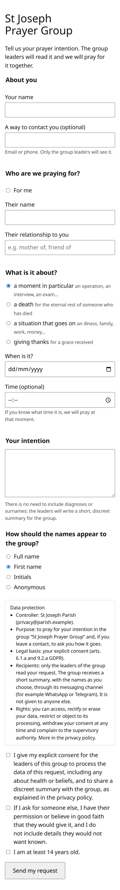

### Defences against abuse

- An invisible trap field: if a robot fills it in, it is told that everything went well and nothing is stored.
- A limit of 5 requests per hour from the same connection.
- Cloudflare Turnstile, optional: it is switched on by entering its two keys in "Global settings".

### After sending

The person who asks sees "Thank you. We have received your request and will pray for it." (the text can be changed in the settings). The request waits in "Moderation", and the leaders get a notice:

- **by email**, with who asks, for whom, the kind and, by default, the full text;
- **by Telegram or webhook**, only that there is a new request and the link to moderate it, never the text.

If something goes wrong, the form is shown again with what was written and a message explaining what is missing.

## Keeping track of intentions in the panel

Each group has its page with eight tabs: "Moderation", "Intentions", "Reviews", "Daily digest", "Monthly digest", "Members", "Group settings" and "Activity". This section covers the first three.

### Moderation

Requests from the form arrive here, from the oldest to the newest. Each card shows who asks, for whom, the kind, the date, the discretion chosen and the full text. There are three ways out:

- **"Approve"**: write the "Summary for the index" (up to 100 characters; it is the only thing the group will see), adjust the discretion if needed (only stricter) and the priority.
- **"Discard"**: as "Spam" or "Duplicate". It is final.
- **"Merge as duplicate"**: discards it and adds its text as an internal note to the intention that already existed.

Approving does not set the message, the topic or whether the person is one of our group: those are adjusted afterwards, by editing the intention.

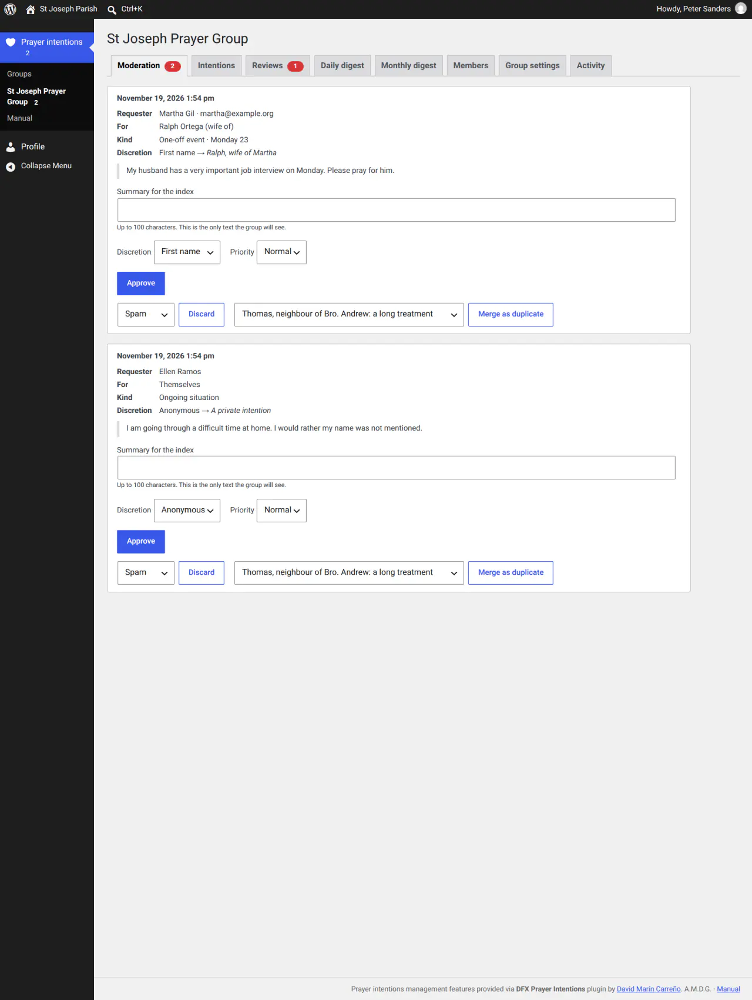

### The list of intentions

The "Intentions" tab lets you filter by status, kind, priority, dates and name. Urgent ones come first, marked with ❗. The "Add intention" button opens an empty card; an intention added by a leader is active at once.

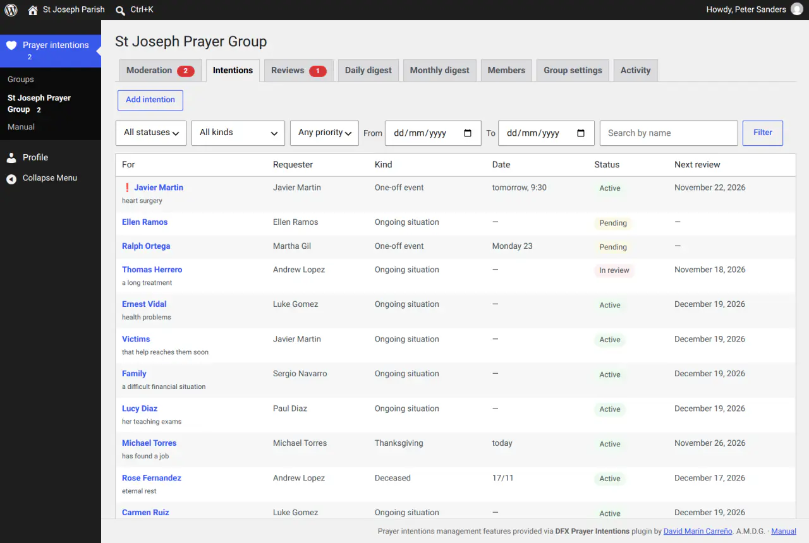

### An intention's card

The card has five steps, the same as in the app. Fields that do not apply to the kind are hidden.

1. **"Who asks"**: "Full name", "How we call them" (a nickname or a compound name: Toni, Juan Tomás, Javi Cavallé), "WhatsApp", "One of our group", "When they asked" and, once it is on the list, "When it reached the list". While it is new, an intention goes in "Especially"; to take it out sooner (for instance, after an operation that is already over), set "When it reached the list" to an earlier day. It cannot be after today nor before "When they asked".
2. **"Who we pray for"**: "For themselves", or the name, how we call them, "What they are to the requester" ("mother of") and "One of our group".
3. **"What is happening"**: the kind ("A situation", "Something with a date", "A death", "A thanksgiving"), the date and the time, "Remember it every year" for the departed, the "Key dates" (funeral, month's mind Mass, medical appointment…) and "What they told us", which is never published.
4. **"How it appears in the message"**: the "Summary", a preview of the line, the message ("Daily message" or "Only the monthly list"), the topic (General, Health, Studies, exams and work, Economic or legal problems, Current affairs), the priority ("Urgent: it opens “Especially”") and, folded, "Discretion and names".
5. **"Follow-up"**: "Look at it again on" (the next review), "Or pray for it only until" (it stops appearing and closes by itself the next day) and "Pending to ask", with the button to ask by WhatsApp.

In "Discretion and names" you can write a description instead of the name, such as "Bro. John's daughter". It replaces the whole description of the person, does not accept surnames with first-name discretion, and can never reveal more than the level allows.

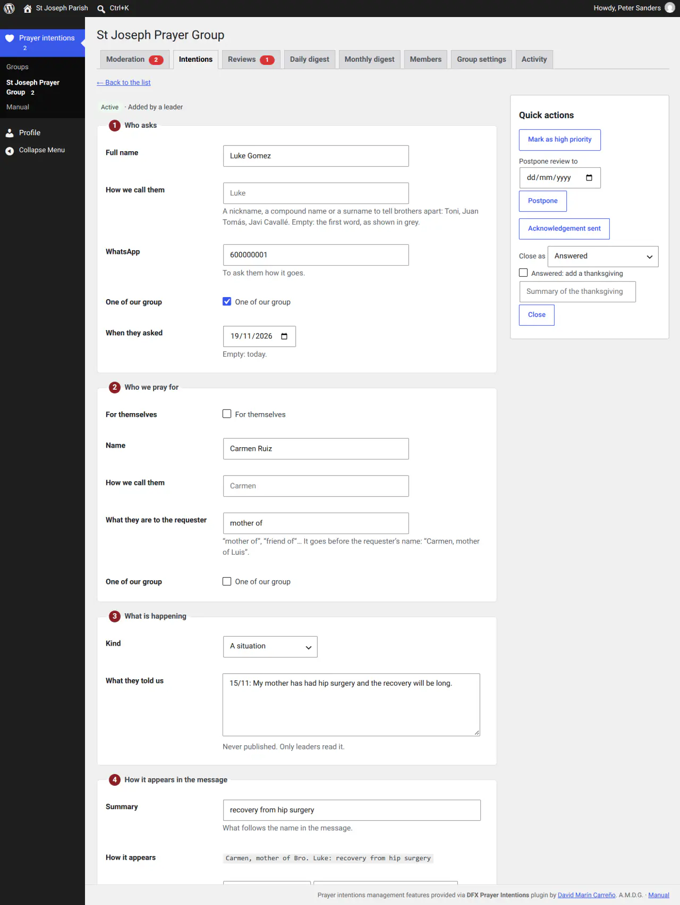

### Below the card

- **"Updates"**: what becomes known ("the operation went well"). With "Show as news in the daily digest", ticked by default, it reaches the group as news. Adding one clears "Pending to ask".
- **"Internal comments"**: contacts, calls, visits and notes. Only leaders see them; they can be edited, deleted or turned into an update.
- **"History"**: every change, who made it and when.

### Quick actions

On the side of the card:

| Action | What it does |
| --- | --- |
| "Mark as high priority" / "Back to normal priority" | Moves it up to "Especially" or back to its place |
| "Still current" | For an intention in review: it goes back to active with a new review date |
| "Postpone review to" | Moves the review to a later date |
| "Acknowledgement sent" | Notes that the person who asked has already been answered |
| "Move to" | Moves it to another group you also lead |
| "Close as" | "Answered", "Expired" or "Withdrawn by the requester" |
| "Reopen" | For one closed by mistake: it goes back to active with its history |

When an event or a situation is closed as "Answered", the "Answered: add a thanksgiving" checkbox creates a thanksgiving with its own short summary ("came through the operation very well"). That way the group gives thanks in the next message. When the box is ticked, "In the daily and monthly digests it will appear as:" shows the exact line below it, which changes while you write the summary (left empty, the intention's own summary is used). Pressing "Close" opens the new thanksgiving, which is edited like any other intention. Each links to the other: the thanksgiving shows "Gives thanks for:" and the closed intention "Its thanksgiving:". The app works the same way.

### The lifecycle

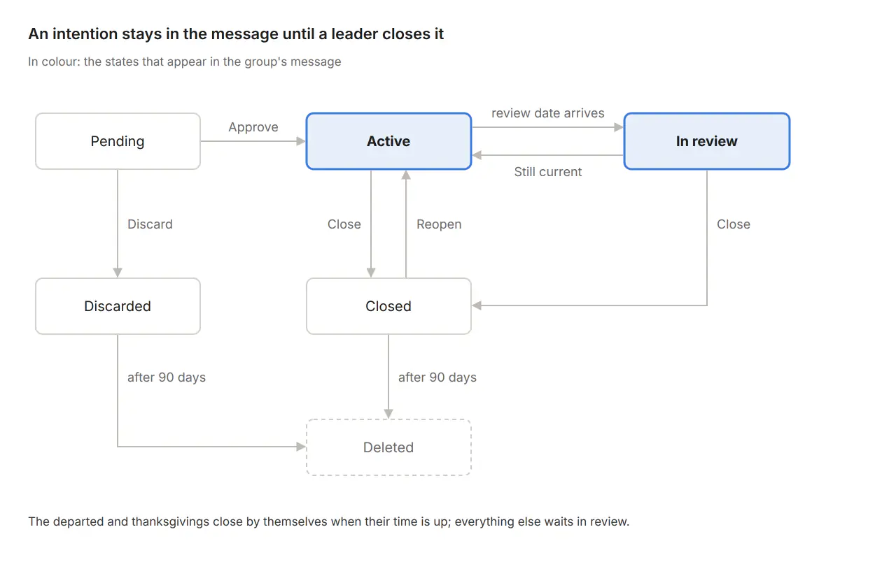

Each active intention has a review date. When it arrives, the intention moves to "In review", but it stays in the message until a leader decides.

| Kind | First review (by default) |
| --- | --- |
| Something with a date | 2 days after the date |
| A death | 30 days after the death; it closes by itself |
| A thanksgiving | 7 days later; it closes by itself |
| A situation | Every 30 days |

Intentions with "Or pray for it only until" close by themselves the day after that date. The departed with "Remember it every year" are never deleted: their anniversary comes back to the message every year.

### Reviews

The "Reviews" tab gathers the intentions that have reached their review date. **They keep appearing in the message until a leader decides**: nobody stops praying because of an administrative oversight. Each card offers "Still current" or closing it.

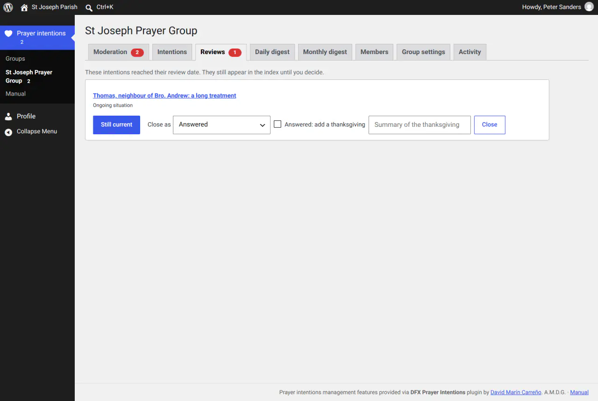

### Activity

The group's last 200 events: requests received, approvals, changes, closings and deliveries. The "Failed deliveries" filter shows only what did not get through by email, Telegram or webhook.

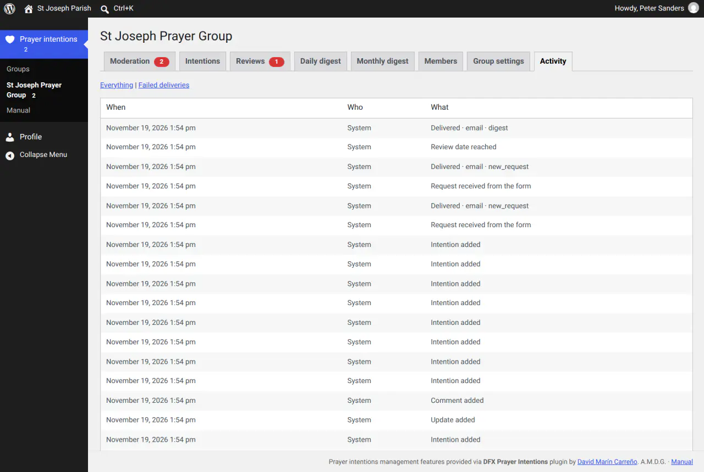

## The message for the group

The plugin composes the message from the current intentions, ready to paste into WhatsApp: bold with asterisks, bullets and a blank line between sections. Nobody types it by hand. If something comes out wrong, you correct the intention and the message changes by itself.

### How each line is written

- **The name**, according to the discretion: full, "How we call them" or the first name, the initials, or "A private intention" if it is anonymous.
- **The members' prefix**, if the group has one set (for example "Bro."), before whoever is marked as "One of our group".
- **The relationship**, when someone asks for another person: "Carmen, mother of Bro. Luke".
- **The summary**, after a colon.
- **The date**, for events ("*(today, 8:30)*", "*(tomorrow)*", the day of the week or dd/mm) and for the departed ("(† dd/mm)").

### Two layouts

It is chosen in "Index layout", in the settings.

**"By kind"** (the default layout) groups the intentions in "Upcoming events", "For our departed", "The sick and difficult situations" and "Thanksgiving". Each intention appears for its whole lifetime.

**"Prayer proposals"** is a shorter daily message, meant to be read every day:

| Section | What goes in |
| --- | --- |
| "Especially" | The departed who are news, death anniversaries, members' birthdays, serious news from the last day, and urgent intentions |
| "For the health of" | The Health topic: only the names, in one line for everyone, those of the group first |
| "Also for" | The General, Studies and Economic topics. Those with the same summary are joined in one line |
| "We also pray for" | The Current affairs topic |
| "We give thanks" | Thanksgivings, for 1 day (configurable) |
| "For our departed" | Those who died in the last 7 days (configurable) |

With "Only the monthly list", an intention does not appear in the daily message, but it does in the monthly list. It is useful for situations that go on without news, or for distant acquaintances.

### The monthly list

It gathers all the current intentions, whether daily or monthly, to read them at the monthly adoration. Its sections are "Especially", "For the sick", "Studies, exams and job interviews", "Economic or legal problems", "Other intentions", "We also pray for", "We give thanks" (those of the last month) and "For our departed" (those of the last month).

The studies section always ends with a generic line, "For those who study, sit exams or look for work", so single exams do not need an intention of their own.

### Header, footer and length

The header and the footer are changed in the settings, with `{date}` (dd/mm) and `{long_date}` ("Thursday, November 19, 2026"). If the message goes over 4,000 characters, the "Daily digest" tab warns that it may be long to read in one go.

A theme can change the texts by copying the templates from `templates/` to `your-theme/dfx-prayer-intentions/`.

## Digests, alerts and channels

The daily digest gathers every morning what the group shares and what only the leaders need. Hour alerts make it possible to pray at the exact moment of an operation or an interview.

### The "Daily digest" tab

It shows two versions, each with its "Copy" button:

- **"Shareable version"**: the message for the group, the same one the app shows.
- **"Leaders’ version"**: the same message, with who asks for each intention (and their phone, if so configured), followed by a "🔒 Leaders only" block.

The leaders' block contains:

- **"Today"**: the day's events by time, and the key dates.
- **"Without an hour alert"**: what falls within the quiet hours.
- **"Pending in the panel"**: requests to moderate and overdue reviews, with their link.
- **"To ask"**: whom to ask how things are going.
- **"News of the last 24 hours"**.

At the top it says whether today's digest has already gone out and at what time. The "Generate and send now" button sends it at once through the group's channels, even if it had already been sent.

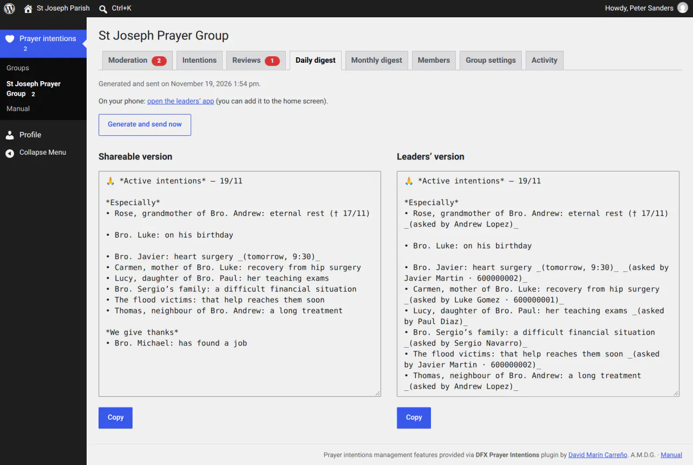

### When it goes out

- By default, every day at 07:00 ("Daily digest at").
- If it is left **empty**, it does not go out by itself: only when someone presses "Generate and send now", or when a routine asks for it at the end of its work.
- "When there is nothing new" decides between sending a short version or sending nothing.

### The monthly digest

The "Monthly digest" tab has the monthly list in its two versions. **It is never sent by itself**: you copy it from here or from the app.

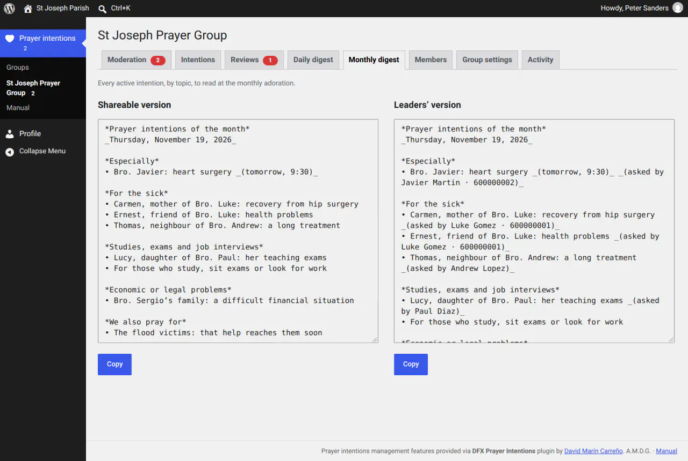

### Hour alerts

For events with a time, the plugin sends an alert 15 minutes before: "At 8:30: … United in prayer." It can send a second alert at the exact time.

Between 23:00 and 07:00 (the quiet hours, configurable) no alert goes out. Those events appear under "Without an hour alert" in the leaders' digest. If no digest picked them up, an early alert goes out just before the quiet hours. That way no event is left without notice.

### Channels

The panel always offers copying and pasting into WhatsApp. In "Group settings › Channels" three automatic channels are switched on; each one chooses whether it receives the daily digest, the hour alerts and new requests.

| Channel | What is configured | What it receives |
| --- | --- | --- |
| Email | Recipients; empty = every leader with an email, except service accounts | Always the leaders' version, with bold and links |
| Telegram | Bot token and chat ID | The shareable version or the leaders' version (only in a private leaders' chat) |
| Webhook | URL and signing secret | JSON signed with HMAC-SHA256, for Slack, Discord, n8n… |

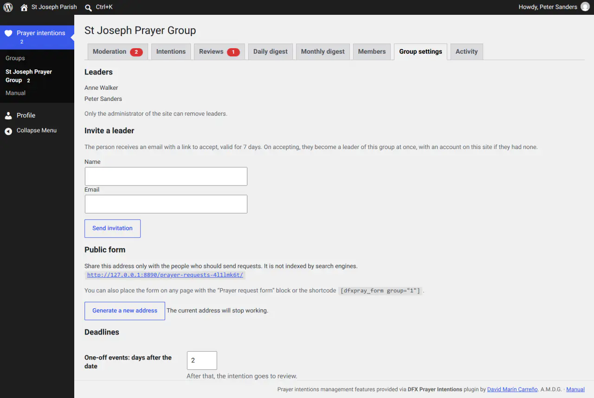

By default only email is active, for the digest and new requests.

"Test the channels" sends a test message through each one. Whatever does not get through is recorded in "Activity › Failed deliveries" with the reason.

WhatsApp has no automatic channel: its official API cannot post to groups created by individuals, and unofficial ways risk getting the number blocked.

## The members of the group

The "Members" tab keeps the members of the group, to name them properly and to pray for them on their birthday, which opens "Especially" in the daily message. Only leaders see it.

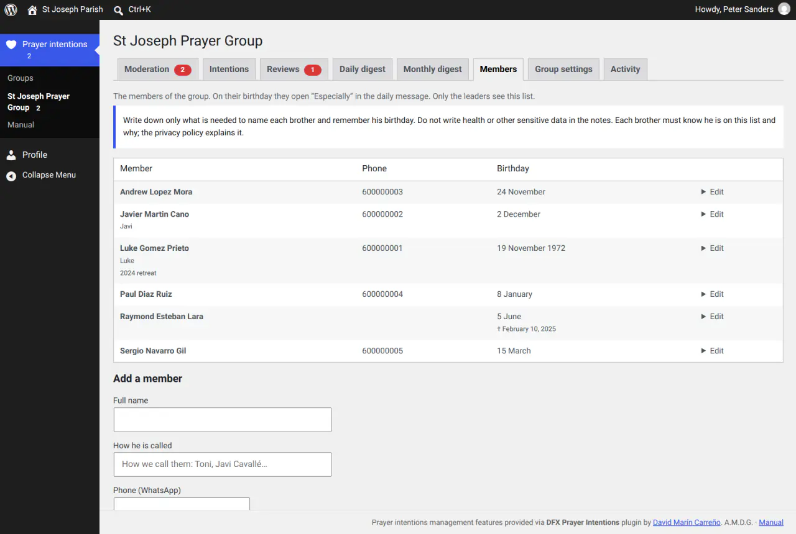

### Each member's details

| Field | What it is for |
| --- | --- |
| "Full name" | Required |
| "How he is called" | Toni, Javi Cavallé… Empty: the first word of the name |
| "Phone (WhatsApp)" | To write to them from the app |
| "Birthday" | Day and month, and the year if you like. Someone born on 29 February celebrates it on the 28th in non-leap years |
| "Date of death" | They are no longer mentioned on their birthday, and the group prays for them every year on the anniversary |
| "Notes" | Internal, for example "11th Retreat – Table 1" |

Write down only what is needed to name each member and remember their birthday. Do not write health data or other sensitive data in the notes.

If two members would be named the same way, the message adds the first surname to tell them apart.

"Edit" opens a member's fields with "Save" and "Delete". Careful: "Delete" does not ask for confirmation. "Add a member", at the end, creates a new one.

The list of members is different from the "One of our group" checkbox of each intention: that checkbox is what decides whether the prefix ("Bro.") is written in the message.

## Settings

"Global settings" (administrators only) sets the values for every group. "Group settings" changes them for a single group, and "Reset this group to the global settings" undoes those changes.

The first time "Group settings" is saved, the group keeps all the values of that moment. Later changes in "Global settings" no longer reach it until it is reset to the global settings.

### Time limits

| Setting | Default |
| --- | --- |
| "One-off events: days after the date" | 2 |
| "Deceased: days after the death" | 30 |
| "Close the deceased when that time is over" | Yes |
| "Ongoing situations: review every (days)" | 30 |
| "Thanksgiving: days" | 7 |
| "Close thanksgivings when their days are over" | Yes |
| "“Still current”: days until the next review" | 30 |
| "Daily message: departed during (days)" | 7 |
| "Daily message: news go first during (days)" | 1 |
| "Daily message: thanksgivings during (days)" | 1 |
| "Daily message: pray for the members on their birthday" | Yes |
| "Monthly list: thanksgivings of the last (days)" | 30 |

### Texts

| Setting | Default |
| --- | --- |
| "Message after sending the form" | "Thank you. We have received your request and will pray for it." |
| "Index header" | "🙏 *Active intentions* – {date}" |
| "Monthly list header" | "*Prayer intentions of the month*" and the long date |
| "Index footer" | Empty |
| "Index layout" | "By kind" |
| "Prefix for members of the group" | Empty (for example, "Bro.") |
| "Emojis in the index sections" | No |
| "Include recent internal comments in the leaders’ digest" | No |

### Times

| Setting | Default |
| --- | --- |
| "Daily digest at" | 07:00 (empty: only when sent by hand) |
| "When there is nothing new" | "Send a short version" |
| "Hour alerts: minutes before" | 15 |
| "Second alert at the exact time" | No |
| "Quiet hours from" / "To" | 23:00 / 07:00 |

### Personal data in the messages

| Setting | Default |
| --- | --- |
| "Include the full text of new requests in the email notice" | Yes |
| "Include the requesters’ phones in the leaders’ digest" | Yes |

### Only in "Global settings"

| Setting | Default |
| --- | --- |
| "Provider of the service (data processor)", tax ID, address and email | Empty: the site itself is the controller |
| "Subprocessors" | Empty: the site's hosting and email providers |
| "Default data controller" and its contact | The name of the site |
| "Minimum age to send requests" | 14 |
| "Delete closed and discarded intentions after (days)" | 90 |
| "Country code for phone numbers" | 34 |
| "Beginning of the form addresses" | "prayer-requests" ("peticiones" on a Spanish site; it also gives the app's address) |
| "Maximum requests per hour from one connection" | 5 |
| Cloudflare Turnstile keys | Empty: switched off |
| "Delete all data when the plugin is uninstalled" | Yes |
| "Access to the panel" | Roles that can lead groups |

Channels (email, Telegram, webhook) are configured only in each group.

## The leaders' app

The app brings the panel to the phone: today's message ready to share, the intentions with their follow-up, whom to ask, birthdays and a quick form to add. It also works offline.

### Installing it

The address is the site's followed by `/prayer-requests-app/` (on an English site; it changes if "Beginning of the form addresses" is changed). You log in with the same WordPress username and password, and the app remembers the session.

- **Android (Chrome)**: ⋮ menu › "Install app" or "Add to Home screen".
- **iPhone (Safari)**: Share button › "Add to Home Screen".

It stays as one more icon, called "Prayer", which opens full screen. The "Daily digest" tab of the panel has a direct link.

When you open the panel on a phone or tablet, the top of every screen shows "Install the app on your phone:" with the app's address, the "Copy link" button and, under "How to install it", these two steps; the "Prayer intentions" menu also has the "Install the app" entry. On a computer none of this appears.

If you open the app on a phone without having installed it, an "Install the app" button appears above "Today" (on Android with Chrome), or the hint to tap Share and then "Add to Home Screen" (on iPhone and iPad). It disappears as soon as the app is installed.

### The screens

The bar at the bottom has six buttons. If you lead several groups, there is a selector at the top to choose the group, and the app remembers the last one.

| Screen | What is there |
| --- | --- |
| "Today" | The day's message ("Daily") or the "Monthly list", with "Share" (opens WhatsApp or another app) and "Copy" |
| "Intentions" | The list with a search box and a filter: "Current", "To review" or "Closed". Urgent ones are highlighted |
| "To ask" | Whom to ask how things are going, grouped by the person who asked, with a WhatsApp button that already has the question written |
| "Members" | Birthdays and anniversaries by month, with the current month open and a button to write by WhatsApp |
| "Moderation" | Requests to moderate and intentions to review |
| "Add" | The panel's five-step card, with "How it will appear": the line exactly as it will be in the message |

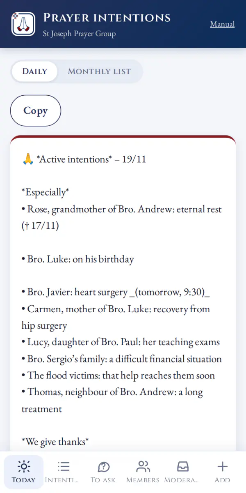
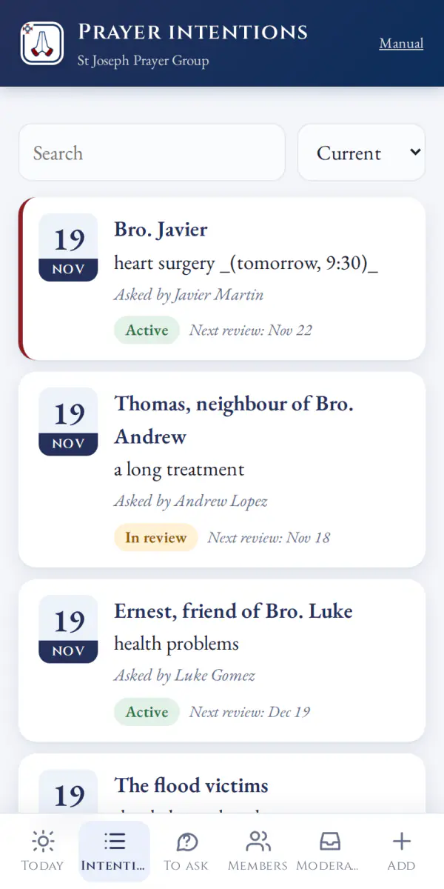
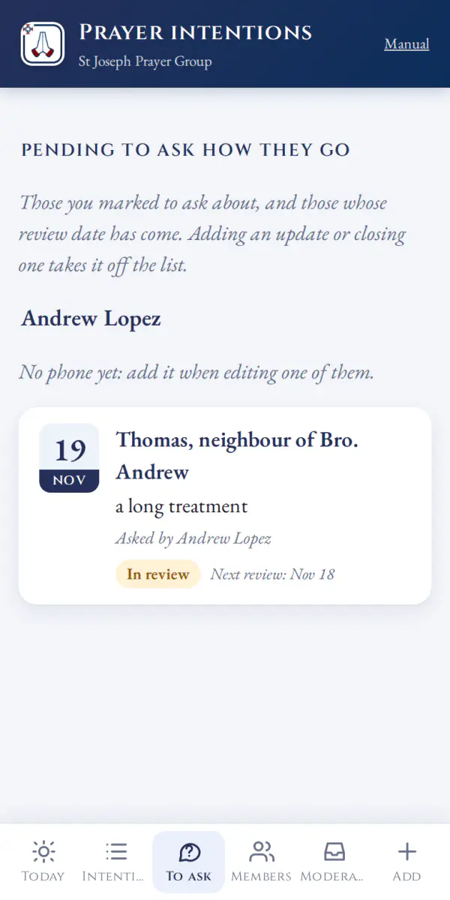
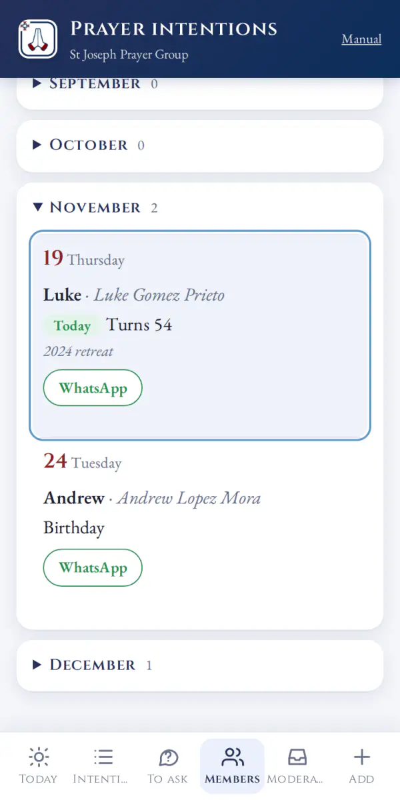
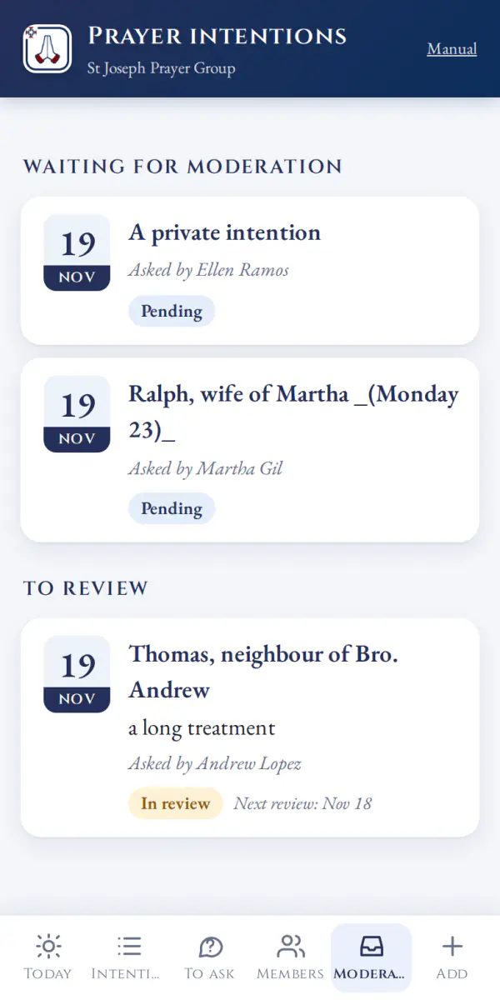
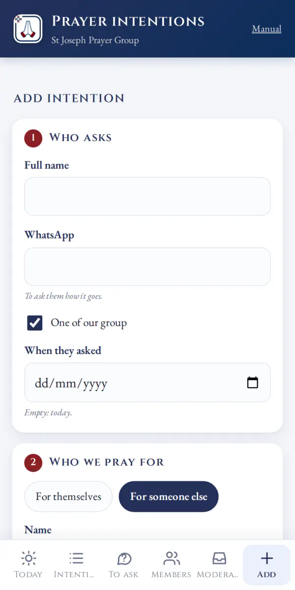

The "To ask" question comes out as "Hi Luke, how is Carmen doing (hip surgery)?". If there are several, it asks about all of them at once. Adding an update or closing the intention takes it off the list.

### An intention's card in the app

Tapping an intention shows its line, who asks, the "Full text" (folded) and its updates. From there you can:

- **if it is pending**: write the summary and "Approve", or "Discard" (it asks for a second tap and discards it as spam);
- **if it is current**: add an update, "Still current", change the priority, postpone the review or close it (with a thanksgiving if it was answered);
- **if it is closed**: "Reopen";
- and always "Edit" and "Ask by WhatsApp how it goes".

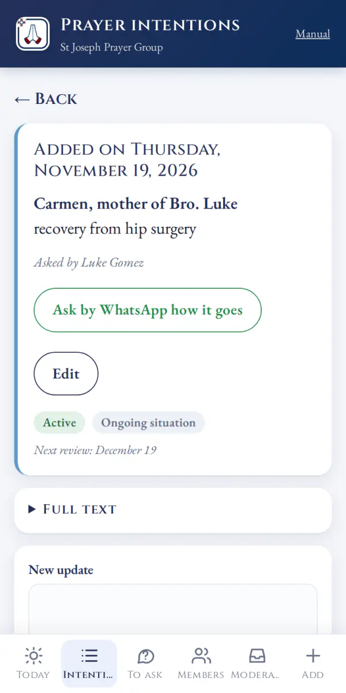

Only the panel has internal comments, merging, moving, the acknowledgement, editing members, the settings and the leaders' digest.

### Offline

- The app keeps the last message and the lists on the phone, only with the summarised lines, never the full text. Without coverage it shows them with the notice "No connection: showing the last data saved on this device."
- Whatever you do offline is queued ("Waiting to be sent: N") and sent as soon as the network is back.
- An intention's card and "Members" need a connection.
- If an intention added or edited offline is waiting in the queue, what was written, "What they told us" included, is kept on the phone until it is sent.

The app's session lasts about a day. After that, "The session has expired. Reload the app." appears: just reload it.

## Automatic routines

A routine is a program of the leader's own that keeps the list up to date without opening the panel: for example, one that reads the group's news every morning, records it and sends the digest when it finishes. It comes in through a single route of the REST API with an application password, and it has exactly the same permissions as its user in the panel.

### Preparing a routine

1. **Create a user of its own for the routine**, with the "Prayer leader" role, and mark it as a leader only of the groups it is going to handle.
2. **Mark it as a service account**: an administrator, in the user's profile, "DFX Prayer Intentions" section, switches on "Only a routine uses this account".
3. **Create an application password** in that same profile (WordPress' "Application Passwords" section). Keep it where only the program reads it, never in the text of the routine.

If a security plugin switches off application passwords (Wordfence does it with "Disable WordPress application passwords"), the route will always answer 401 until they are allowed.

### What changes with a service account

- It keeps the permissions of the groups it leads, and nothing else.
- It receives no email from the plugin.
- Its application passwords only open the plugin's route: the rest of the WordPress API answers 403, and XML-RPC rejects them.
- In the list of leaders it appears with "· service account".

### The route

`POST /wp-json/dfxpray/v1/<operation>` (or `/?rest_route=/dfxpray/v1/<operation>`), with basic authentication (username and application password) and the data in JSON. It answers `{ok, code, message, id, data}`. Without an application password, 401; outside the user's groups, 403.

| Operation | Does |
| --- | --- |
| `bootstrap` | The user's groups |
| `list` | A group's intentions, by status or searching text |
| `get` | An intention with its line and its updates |
| `index` | The message to share, daily or monthly |
| `digest` | Today's digest and whether it has already been sent |
| `members` | The group's members |
| `preview` | The line that would come out, without saving anything |
| `save_intention` | Creates or edits an intention |
| `add_update` | Adds an update |
| `close`, `reopen`, `keep_active`, `postpone`, `set_priority` | The panel's quick actions |
| `approve`, `discard` | Moderating |
| `send_digest_now` | Sends the daily digest, like "Generate and send now" |
| `save_member` | Creates (`member_id` 0 and `group_id`) or edits (`member_id`) a member of the group; only the fields sent in `member` change (`name`, `called`, `phone`, `birth_day`…). Deleting members stays in the panel |

The fields are the same as those of the panel's cards. For the digest to go out right when the routine finishes, leave "Daily digest at" empty and have the routine call `send_digest_now` at the end.

## Data protection

Prayer requests often carry health and belief data about third parties, so the plugin is built to keep the minimum, show it only to those who should see it, and make it possible to find and erase it. This is not legal advice: review your case with a professional.

### Who is responsible for the data

- **Each group has its data controller** (for example, the parish), with its contact and, if it wants, its own privacy policy. The administrator writes it down in the group's card.
- **If another person or organisation provides the site**, they appear in "Global settings" as "Provider of the service", acting as data processor for each group. Each group accepts its data processing agreement, whose text is copied from the group's card, and the date is noted.
- **The form informs** about the controller, the provider, the purpose, the legal basis (explicit consent), the recipients and the rights, with a link to the privacy policy.

### What the plugin does by design

- No request is stored without the three checkboxes of the form.
- The full text is never published: only the leaders read it, and it only travels by email.
- Discretion can only be tightened, never relaxed.
- Intentions live in their own tables, away from posts, feeds, searches and sitemaps.
- Closed and discarded intentions are deleted after 90 days, with their updates, comments and history. The IP of whoever sends the form is only kept as an irreversible fingerprint (hash) for one hour, to limit abuse.
- The app does not keep the full text of requests on the phone.

### Requests from people

In "Global settings › Requests about personal data" you search by email or by phone, in any format (with or without spaces, with or without the country code, such as +34 or 0034). The result gathers everything the plugin keeps about that person, as requester or as member, to copy it and hand it over. "Erase everything found" deletes it; it cannot be undone.

The plugin also works with the WordPress tools *Tools › Export Personal Data* and *Erase Personal Data*, which search by email only.

### Privacy policy

The plugin suggests a text for the WordPress privacy policy guide. It explains who processes the data, which data and what for, who sees it (including a possible routine of the leader), the optional services, the time limits, the rights of the people prayed for, the members, minors, and the right to complain to your data protection authority (in Spain, the AEPD).

Each leader sees the confidentiality notice when they open their group, until they press "Understood".

## Frequently asked questions and problems

**The digest or the alerts arrive late, or not at all.** WordPress only runs its tasks when someone visits the site. Set up a system cron job that calls `wp-cron.php` every five minutes. Also check that "Daily digest at" is not empty, and that the alert does not fall within the quiet hours.

**"Bro." does not appear before the members' names.** "Prefix for members of the group" comes empty: write it in the settings. And tick "One of our group" in the intention.

**"Especially", birthdays, the health line and "Current affairs" do not appear.** They belong to the "Prayer proposals" layout; the default layout is "By kind". Change it in "Index layout".

**I changed a global setting and a group does not notice.** That group saved its own settings. Use "Reset this group to the global settings", or change the value in "Group settings".

**The monthly digest does not arrive by email.** It is never sent by itself: copy it from the "Monthly digest" tab or from "Today › Monthly list" in the app.

**"The form expired. Please send it again."** The form carries a security code that expires. If it happens often, the page is in a cache: exclude it by hand.

**"Too many requests from your connection."** The limit of 5 requests per hour from the same network has been reached, which can happen on a parish's wifi. Raise the limit in "Global settings".

**The form says "This form is not available." or the address gives a 404 error.** The group is archived, or a new address was generated and the old one no longer works.

**"Write the summary for the index before activating the intention."** Every active intention needs a summary, of up to 100 characters.

**"With “first name” discretion, the description cannot include surnames."** Remove the surnames from the description, or use "How we call them".

**"The session has expired. Reload the app."** Reload the app; if it asks for username and password, log in again.

**An email, a Telegram message or a webhook does not arrive.** Use "Test the channels" and look at the reason in "Activity › Failed deliveries". Remember that service accounts do not receive emails.

**WhatsApp links do not open the right chat.** Check "Country code for phone numbers" (34 by default) and the number stored.

**Can it post only to our WhatsApp group?** No. You copy and paste it, or share it from the app.

**A routine gets 401.** The application password is not valid, it was revoked, or a security plugin switches off application passwords.

**I am going to uninstall the plugin.** By default all data is deleted. If you do not want to lose it, first switch off "Delete all data when the plugin is uninstalled" in "Global settings".
