# Manual de DFX Prayer Intentions

English version: [DFX Prayer Intentions User Manual](../en/README.md)

Versión 1.0.2611270 · noviembre de 2026

Este manual también está en el propio panel, en «Intenciones de oración › Manual», con sus capturas.

## Qué es y para quién

DFX Prayer Intentions ayuda a los responsables de un grupo de oración a llevar las intenciones que reciben, decidir cómo se nombra a cada persona y compartir cada día un mensaje con el grupo. Este manual cubre la versión 1.0.2611270 del plugin para WordPress y su app para el móvil.

Las capturas de este manual son de una web de pruebas con datos inventados.

Las intenciones llegan de palabra, por mensaje o en un papel. Unas son para la operación de mañana, otras por alguien que murió la semana pasada, otras por una enfermedad que dura meses. El plugin da a cada grupo un panel privado para ese trabajo, y a todos los demás una sola cosa: un formulario para pedir oración.

### Las piezas

| Pieza | Quién la usa | Para qué |
| --- | --- | --- |
| Formulario de peticiones | Cualquiera que tenga la dirección | Pedir oración, eligiendo cómo puede aparecer su nombre |
| Panel del grupo (escritorio de WordPress) | Los líderes de cada grupo (también los administradores, solo en los grupos que llevan) | Moderar, llevar las intenciones, preparar el mensaje y el resumen |
| App para responsables (PWA) | Responsables, desde el móvil | Lo mismo que el panel, en el bolsillo y sin conexión |
| Resumen diario y avisos | Responsables, por correo, Telegram o webhook | Saber cada día qué hay, y rezar a la hora de cada acontecimiento |
| Rutinas | Un programa del propio responsable | Mantener la lista al día de forma automática |

### Conceptos básicos

- **Grupo**: un grupo de oración, con sus responsables, su formulario, su mensaje y sus ajustes. Un sitio puede tener varios grupos independientes; con uno solo, el plugin se comporta como si los grupos no existieran.
- **Intención**: una petición de oración. Tiene un texto completo, que nunca se publica, y un resumen corto escrito por un responsable, que es lo único que ve el grupo.
- **Tipo**: un momento concreto, un fallecimiento, una situación que se alarga o una acción de gracias. El tipo decide cuánto tiempo sigue la intención en la lista.
- **Discreción**: cómo puede aparecer el nombre (completo, nombre de pila, iniciales o anónimo). La elige quien pide, y los responsables solo pueden hacerla más estricta.
- **Mensaje para el grupo**: la lista de intenciones vigentes, lista para pegar en WhatsApp. Lo genera el plugin; no se redacta a mano.

Nada de esto se publica en la web: las intenciones viven en tablas propias del plugin, fuera de entradas, buscadores, feeds y mapas del sitio.

## Instalación y primeros pasos

El plugin necesita WordPress 6.5 o posterior y PHP 8.1 o posterior, y no depende de ningún servicio externo. Se instala como cualquier otro plugin, subiendo el zip desde *Plugins › Añadir nuevo*.

Al activarlo, crea sus tablas, el rol «Líder de oración» y dos tareas programadas: una cada cinco minutos (revisiones, avisos de hora, resumen) y otra diaria (borrado de lo antiguo).

### Primeros pasos del administrador

1. Da el rol «Líder de oración» a quienes van a llevar un grupo.
2. En «Intenciones de oración › Grupos», crea el grupo y marca sus líderes. Si tú también vas a llevarlo, márcate: un administrador solo ve las intenciones de los grupos de los que es líder.
3. Rellena en ese mismo grupo los datos de «Protección de datos» (ver *Protección de datos*).
4. Comparte la dirección del formulario, que aparece en la ficha del grupo y en «Ajustes del grupo».
5. Configura en el servidor un cron real que llame a `wp-cron.php` cada cinco minutos. Sin él, WordPress solo ejecuta las tareas cuando alguien visita la web, y el resumen y los avisos pueden llegar tarde.

### El menú

- **«Intenciones de oración»**, con un globo que cuenta las peticiones pendientes de tus grupos.
- **«Grupos»**: a los administradores les abre con las **«Estadísticas de todos los grupos»**, una tabla con una fila por grupo (también los archivados) y el total de «Todos los grupos». Son solo cifras: «Líderes», «Miembros» (vivos), «Pendientes», «En la lista» (activas y en revisión), «Recibidas» y «Cerradas» en los últimos 30 días, «Atendidas» desde el principio y «Total recibidas». No muestra nombres ni textos, y el nombre del grupo solo lleva a sus intenciones si el administrador lo lleva. Debajo, para todos, una tarjeta por cada grupo que llevas con sus contadores («Pendientes», «En revisión», «Eventos de hoy», «Eventos de mañana») y los botones «Resumen diario» y «Añadir intención».
- **«Ajustes globales»**, solo para administradores.
- **Una entrada por cada grupo que llevas**, con su propio globo de pendientes. Esto vale también para los administradores: los grupos que no llevan solo aparecen en «Gestionar grupos».

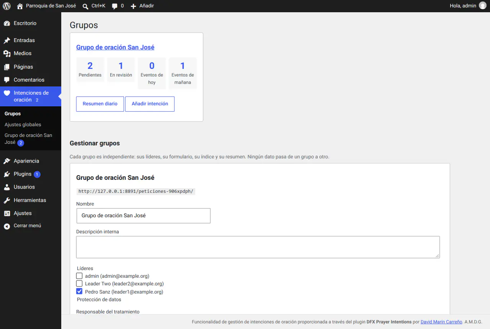

### Avisos al entrar en un grupo

- **Confidencialidad.** Recuerda el deber de reserva sobre enfermedades, fallecimientos y situaciones familiares. Desaparece al pulsar «Entendido», una vez por persona.
- **Protección de datos.** Aparece mientras el grupo no tenga responsable del tratamiento, o falte la fecha del encargo de tratamiento.

> Ojo al desinstalar: la opción «Borrar todos los datos al desinstalar el plugin» viene activada. Si solo quieres desactivarlo un tiempo, desactívalo; no lo borres.

## Grupos, responsables y permisos

Cada grupo es independiente: sus líderes, su formulario, su mensaje y su resumen. Ningún dato pasa de un grupo a otro, y un líder solo ve los grupos que tiene asignados.

### Quién puede hacer qué

| Persona | Ve | Puede |
| --- | --- | --- |
| Administrador | Los grupos activos de los que es líder, como cualquier líder; el resto solo en «Gestionar grupos» (nombre, líderes, protección de datos) y en las estadísticas (solo cifras), sin sus intenciones | Crear, editar, archivar y borrar cualquier grupo; asignar, invitar y quitar líderes; ajustes globales; solicitudes de datos personales de cualquier grupo; marcar cuentas de servicio |
| Líder de oración | Solo sus grupos | Todo dentro de ellos: moderar, intenciones, resúmenes, miembros, «Ajustes del grupo» (canales, plazos, nueva dirección del formulario) e invitar a nuevos líderes |
| Otros roles con acceso al panel | Solo los grupos a los que se les asigne | Lo mismo que un líder |

El rol «Líder de oración» solo da acceso al panel y al propio perfil. Quien solo tiene acceso al panel entra directamente en su grupo al iniciar sesión, sin pasar por el escritorio de WordPress. En «Ajustes globales › Acceso al panel» el administrador puede dar acceso a otros roles.

### Crear y editar un grupo

En «Grupos › Gestionar grupos» (solo administradores) cada grupo tiene una ficha con:

- **«Nombre»** (obligatorio) y **«Descripción interna»**.
- **«Líderes»**: casillas con cada usuario que tiene acceso al panel. Las cuentas de servicio llevan «· cuenta de servicio».
- **«Protección de datos»**: responsable del tratamiento, contacto, política de privacidad propia y fecha en que se aceptó el encargo de tratamiento.
- **«Encargo de tratamiento de este grupo»**: el texto del contrato (artículo 28 del RGPD) listo para copiar.

La tarjeta «Nuevo grupo», al final, crea uno nuevo.

### Invitar a un líder

Cualquier líder de un grupo puede invitar a otra persona a llevarlo, sin pasar por el administrador. Se hace en «Ajustes del grupo › Líderes»:

1. Arriba aparece la lista de los líderes del grupo (solo sus nombres; los administradores ven también su correo) y las «Invitaciones pendientes», cada una con su fecha de caducidad.
2. En «Invitar a un líder», escribe el «Nombre» y el «Correo» de la persona y pulsa «Enviar invitación». El panel responde «Invitación enviada.»; si esa persona ya era líder del grupo, no cambia nada.
3. La persona recibe un correo, «Invitación a ser líder de…», que le recuerda que los líderes ven información muy sensible y deben guardar confidencialidad, con un enlace para aceptar. **El enlace caduca a los 7 días.** Si se vuelve a invitar al mismo correo, se envía un enlace nuevo y el anterior deja de valer.
4. Al abrir el enlace ve la invitación y el botón «Aceptar la invitación». Abrir el enlace no acepta nada: hay que pulsar el botón.
5. Si no tiene cuenta en el sitio, la propia invitación le dice que entrará con su correo y le pide que elija su contraseña («Contraseña» y «Repite la contraseña», de al menos 8 caracteres); al pulsar «Aceptar y entrar» se le crea la cuenta con el rol «Líder de oración», pasa a ser líder del grupo y entra en él directamente, sin tener que iniciar sesión. Recibe además un correo de bienvenida que le recuerda cómo volver: su usuario es su correo, la dirección para entrar, la app de los líderes y dónde elegir una contraseña nueva si la olvida. Si ya tenía cuenta, pulsa «Aceptar la invitación» e inicia sesión con ella.

Quien no recuerde su contraseña puede elegir otra en la pantalla de acceso, con «¿Has olvidado tu contraseña?» y su correo.

El administrador del sitio recibe un correo cada vez que alguien acepta, y el envío, la retirada y la aceptación quedan en «Actividad». Mientras una invitación está pendiente, cualquier líder del grupo puede pulsar «Retirar» y el enlace deja de funcionar. Las invitaciones caducadas se borran solas, y las aceptadas a la semana.

Los administradores pueden invitar además a **cualquier grupo**, también a uno que no llevan o que aún no tiene líderes: en «Grupos › Gestionar grupos», la ficha de cada grupo tiene su bloque «Invitar a un líder» (con «Nombre», «Correo» y «Enviar invitación») y la lista de sus «Invitaciones pendientes», cada una con «Retirar». La invitación funciona igual, y el correo dice que invita el administrador. La tarjeta «Nuevo grupo» no lo tiene: primero se crea el grupo.

**Solo los administradores quitan líderes**, en «Grupos › Gestionar grupos», donde también pueden marcar como líder directamente a cualquier usuario con acceso al panel.

### La dirección secreta del formulario

Cada grupo tiene una dirección propia con una parte aleatoria, por ejemplo `/peticiones-7f3k9q2x/`. No aparece en menús, buscadores ni mapas del sitio: solo la conoce quien la recibe.

Si la dirección se ha difundido donde no debe, «Generar una dirección nueva» en «Ajustes del grupo» crea otra. La anterior deja de funcionar en ese momento.

### Archivar y borrar

- **«Archivar»** saca el grupo de los menús y apaga su formulario, pero conserva los datos. «Restaurar» lo devuelve.
- **«Eliminar el grupo y todas sus intenciones»** lo borra todo: intenciones, actualizaciones, comentarios, historial y miembros. No se puede deshacer.

Con un solo grupo activo, el plugin se comporta como si los grupos no existieran: los líderes entran directamente en él y el bloque del formulario no necesita que se elija grupo.

## El formulario de peticiones

El formulario es lo único que ve quien pide oración: cuenta su intención, elige cómo puede aparecer su nombre y la envía a los líderes, que la leen antes de que llegue al grupo.

### Dónde ponerlo

- **En su dirección secreta**, como página propia con el nombre del grupo.
- **En cualquier página**, con el bloque «Formulario de petición de oración». En el panel lateral del bloque se elige a qué grupo van las peticiones.
- **Con el shortcode** `[dfxpray_form group="ID"]`.

Las páginas con el formulario piden a los buscadores que no las indexen y a las cachés que no las guarden.

### Qué se pregunta

1. **«Sobre ti»**: «Tu nombre» (obligatorio) y, si se quiere, «Una forma de contactarte» (email o teléfono; solo lo ven los líderes).
2. **«¿Por quién rezamos?»**: la casilla «Por mí», o el nombre de la persona y «Su relación contigo» («madre de», «amigo de»…).
3. **«¿De qué se trata?»**, en palabras sencillas:
   - «un momento concreto» (una operación, una entrevista, un examen): pide la fecha y, si se sabe, la hora, «para rezar en ese momento»;
   - «un fallecimiento»: pide la fecha en que falleció;
   - «una situación que se alarga» (enfermedad, familia, trabajo, economía);
   - «dar gracias».
4. **«Tu intención»**: el texto libre. El formulario recuerda que no hacen falta diagnósticos ni apellidos.
5. **Cómo aparecen los nombres**: «Nombre completo», «Nombre de pila» (la opción por defecto), «Iniciales» o «Anónimo».
6. **La información de protección de datos** del grupo y **tres casillas obligatorias**: el consentimiento explícito, la declaración de que la otra persona lo permitiría, y la edad mínima (14 años por defecto).

El botón es «Enviar mi petición». Sin las tres casillas, la petición no se guarda.

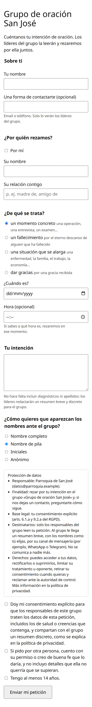

### Defensas contra el abuso

- Un campo trampa invisible: si un robot lo rellena, se le dice que todo ha ido bien y no se guarda nada.
- Un límite de 5 peticiones por hora desde una misma conexión.
- Cloudflare Turnstile, opcional: se activa al poner sus dos claves en «Ajustes globales».

### Después de enviar

Quien pide ve «Gracias. Hemos recibido tu petición y rezaremos por ella.» (el texto se cambia en los ajustes). La petición queda en «Moderación», y los líderes reciben un aviso:

- **por correo**, con quién pide, por quién, el tipo y, por defecto, el texto completo;
- **por Telegram o webhook**, solo que hay una petición nueva y el enlace para moderarla, nunca el texto.

Si algo falla, el formulario vuelve a mostrarse con lo escrito y un mensaje que explica qué falta.

## Llevar las intenciones en el panel

Cada grupo tiene su página con ocho pestañas: «Moderación», «Intenciones», «Revisiones», «Resumen diario», «Resumen mensual», «Miembros», «Ajustes del grupo» y «Actividad». Esta sección cubre las tres primeras.

### Moderación

Aquí llegan las peticiones del formulario, de la más antigua a la más reciente. Cada tarjeta muestra quién pide, por quién, el tipo, la fecha, la discreción elegida y el texto completo. Hay tres salidas:

- **«Aprobar»**: escribe el «Resumen para el índice» (hasta 100 caracteres; es lo único que verá el grupo), ajusta la discreción si hace falta (solo más estricta) y la prioridad.
- **«Descartar»**: como «Spam» o «Duplicado». Es definitivo.
- **«Fusionar como duplicado»**: la descarta y añade su texto como nota interna en la intención que ya existía.

Al aprobar no se eligen el mensaje, el tema ni si es de nuestro grupo: se ajustan después, editando la intención.

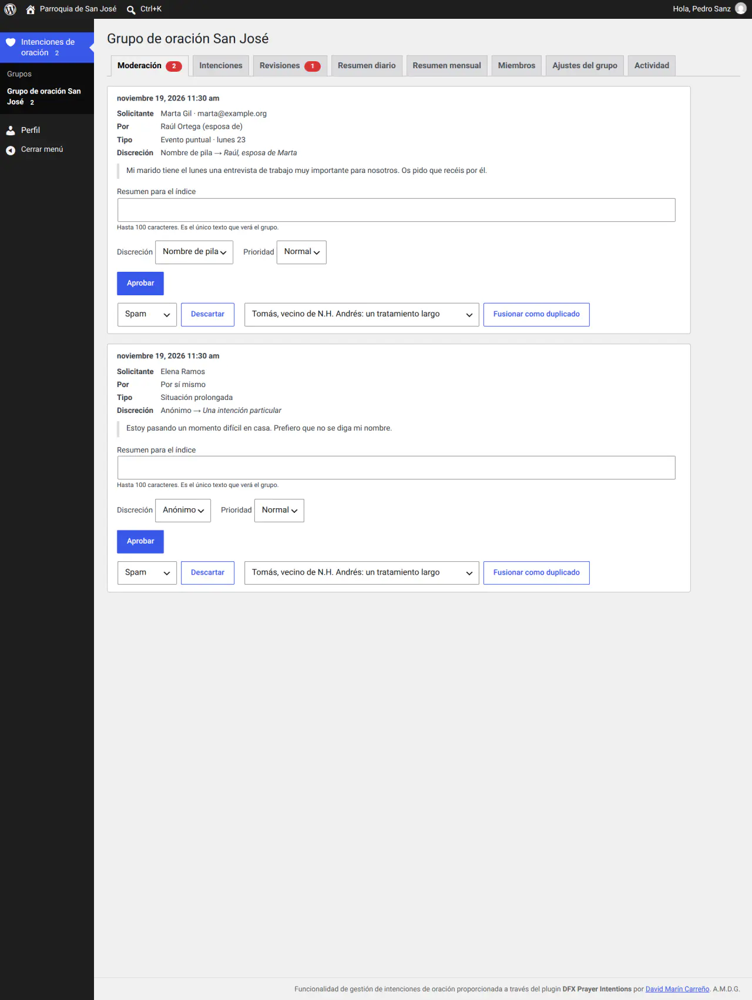

### La lista de intenciones

La pestaña «Intenciones» permite filtrar por estado, tipo, prioridad, fechas y nombre. Las urgentes salen primero, marcadas con ❗. El botón «Añadir intención» abre una ficha vacía; una intención añadida por un líder queda activa en el acto.

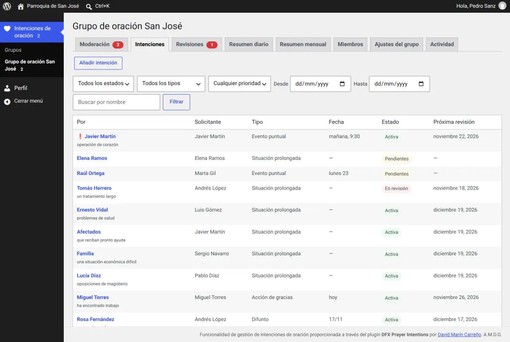

### La ficha de una intención

La ficha tiene cinco pasos, los mismos que en la app. Los campos que no aplican al tipo se ocultan.

1. **«Quién lo pide»**: «Nombre completo», «Cómo le llamamos» (un apodo o un nombre compuesto: Toni, Juan Tomás, Javi Cavallé), «WhatsApp», «Es de nuestro grupo», «Cuándo lo pidió» y, si ya está en la lista, «Cuándo entró en la lista». Mientras es nueva, una intención sale en «Especialmente»; para sacarla antes (por ejemplo, tras una operación que ya pasó), pon en «Cuándo entró en la lista» un día anterior. No puede ser posterior a hoy ni anterior a «Cuándo lo pidió».
2. **«Por quién rezamos»**: «Por sí mismo», o el nombre, cómo le llamamos, «Qué es de quien lo pide» («madre de») y «Es de nuestro grupo».
3. **«Qué pasa»**: el tipo («Situación», «Algo con fecha», «Fallecimiento», «Acción de gracias»), la fecha y la hora, «Recordarlo cada año» para los difuntos, las «Fechas señaladas» (funeral, misa de mes, cita médica…) y «Lo que nos contó», que nunca se publica.
4. **«Cómo sale en el mensaje»**: el «Resumen», una vista previa de la línea, el mensaje («Mensaje diario» o «Solo la lista mensual»), el tema (General, Salud, Estudios y trabajo, Económicos o legales, Actualidad), la prioridad («Urgente: abre “Especialmente”» o «Inmediata: lo primero de “Especialmente”, antes de los cumpleaños») y, plegado, «Discreción y nombres».
5. **«Seguimiento»**: «Volver a mirarla el» (la próxima revisión), «O rezar solo hasta el» (deja de salir y se cierra sola al día siguiente) y «Pendiente de preguntar», con el botón para preguntar por WhatsApp.

En «Discreción y nombres» se puede poner una descripción en lugar del nombre, como «La hija de N.H. Juan». Sustituye toda la descripción de la persona, no admite apellidos con discreción de nombre de pila y nunca puede revelar más de lo que permite el nivel.

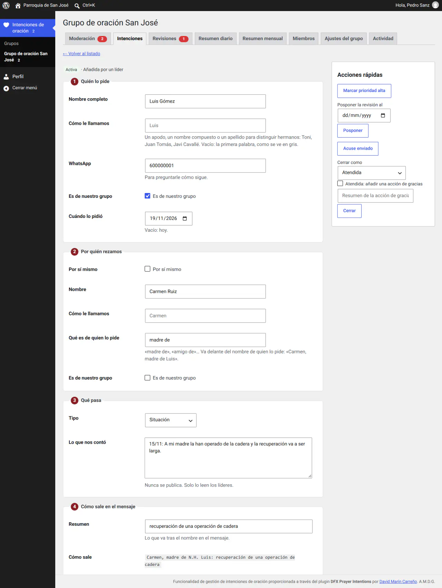

### Bajo la ficha

- **«Actualizaciones»**: lo que se va sabiendo («la operación salió bien»). Con «Mostrar como novedad en el resumen diario», marcado por defecto, llega al grupo como novedad. Añadir una quita «Pendiente de preguntar».
- **«Comentarios internos»**: contactos, llamadas, visitas y notas. Solo los ven los líderes; se pueden editar, borrar o convertir en actualización.
- **«Historial»**: cada cambio, quién lo hizo y cuándo.

### Acciones rápidas

En el lateral de la ficha:

| Acción | Qué hace |
| --- | --- |
| «Marcar prioridad alta» / «Volver a prioridad normal» | La sube a «Especialmente» o la devuelve a su sitio |
| «Marcar prioridad inmediata» | La pone lo primero de «Especialmente», junto a los difuntos que son noticia y antes de los cumpleaños, sea del tipo que sea (también un difunto o una acción de gracias) y hasta que le quites la prioridad |
| «Sigue vigente» | Para una intención en revisión: vuelve a activa con una nueva fecha de revisión |
| «Posponer la revisión al» | Mueve la revisión a una fecha futura |
| «Acuse enviado» | Anota que ya se respondió a quien pidió |
| «Trasladar a» | La pasa a otro grupo que también diriges |
| «Cerrar como» | «Atendida», «Caducada» o «Retirada por el solicitante» |
| «Reabrir» | Para una cerrada por error: vuelve a activa con su historial |

Al cerrar como «Atendida» un acontecimiento o una situación, la casilla «Atendida: añadir una acción de gracias» crea una acción de gracias con su propio resumen breve («salió muy bien de su operación»). Así el grupo da gracias en el mensaje siguiente. Al marcar la casilla, debajo aparece «En los resúmenes diario y mensual aparecerá así:» con la línea exacta, que cambia mientras escribes el resumen (si lo dejas vacío, se usa el de la intención). Al pulsar «Cerrar» se abre la acción de gracias recién creada, que se edita como cualquier otra intención. Cada una enlaza con la otra: la acción de gracias muestra «Da gracias por:» y la intención cerrada, «Su acción de gracias:». En la app funciona igual.

### El ciclo de vida

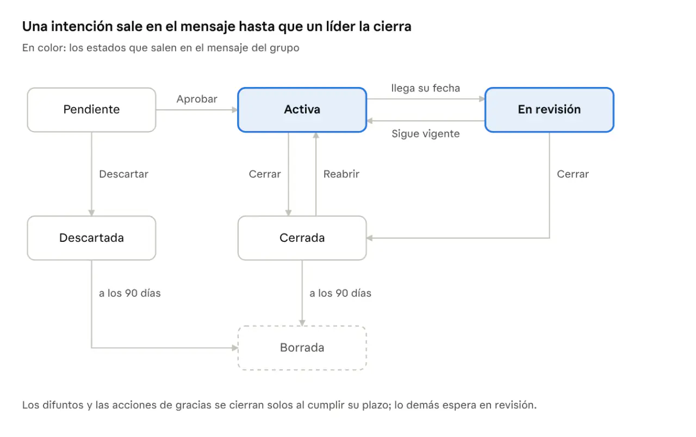

Cada intención activa tiene una fecha de revisión. Al llegar, pasa a «En revisión», pero sigue en el mensaje hasta que un líder decide.

| Tipo | Primera revisión (por defecto) |
| --- | --- |
| Algo con fecha | 2 días después de la fecha |
| Fallecimiento | 30 días después del fallecimiento; se cierra sola |
| Acción de gracias | 7 días después; se cierra sola |
| Situación | Cada 30 días |

Las intenciones con «O rezar solo hasta el» se cierran solas al día siguiente de esa fecha. Los difuntos con «Recordarlo cada año» no se borran nunca: su aniversario vuelve al mensaje cada año.

### Revisiones

La pestaña «Revisiones» reúne las intenciones que han llegado a su fecha de revisión. **Siguen saliendo en el mensaje hasta que un líder decide**: nadie deja de rezar por un descuido administrativo. Cada tarjeta ofrece «Sigue vigente» o cerrarla.

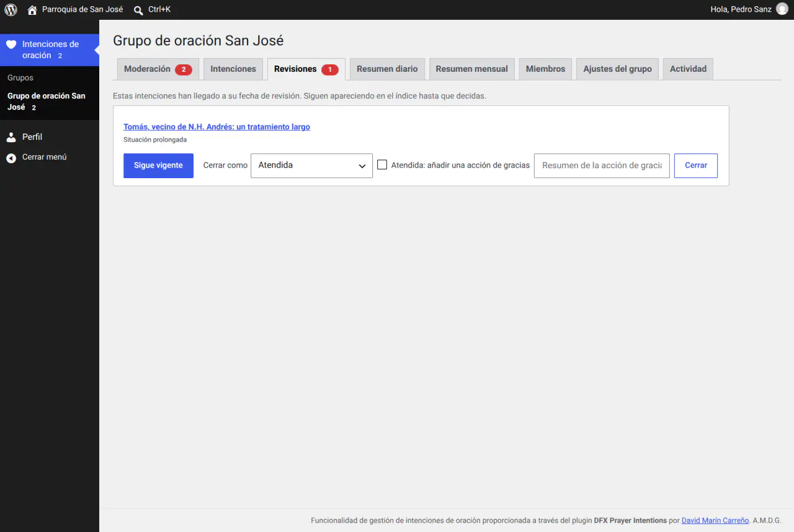

### Actividad

Los últimos 200 movimientos del grupo: peticiones recibidas, aprobaciones, cambios, cierres y envíos. El filtro «Envíos fallidos» muestra solo lo que no llegó por correo, Telegram o webhook.

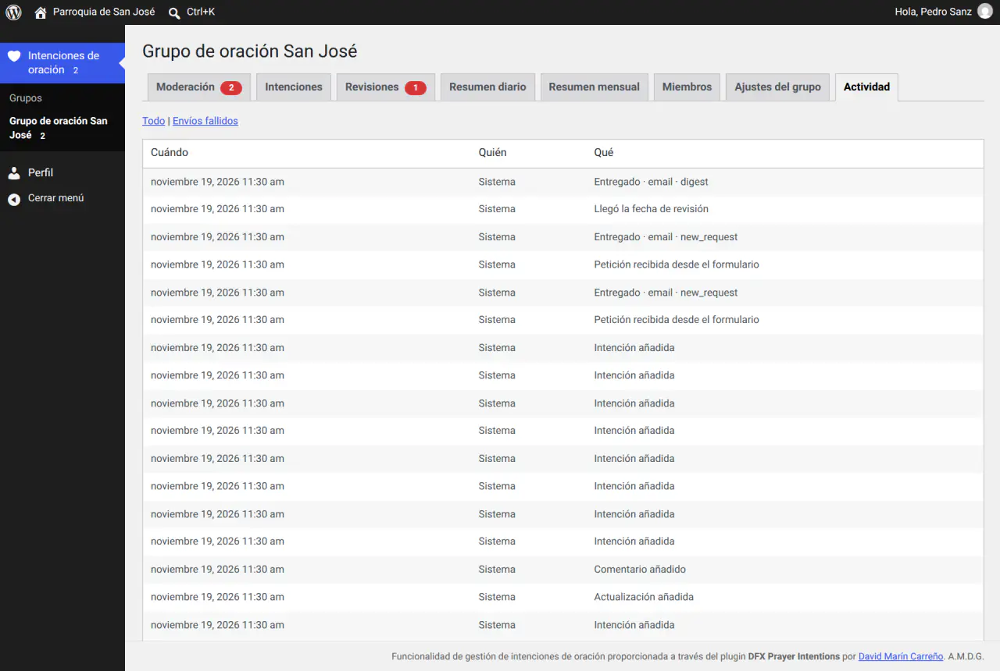

## El mensaje para el grupo

El plugin compone el mensaje con las intenciones vigentes, listo para pegar en WhatsApp: negritas con asteriscos, viñetas y una línea en blanco entre secciones. No se redacta a mano. Si algo sale mal, se corrige la intención y el mensaje cambia solo.

### Cómo se escribe cada línea

- **El nombre**, según la discreción: completo, «Cómo le llamamos» o el primer nombre, las iniciales, o «Una intención particular» si es anónima.
- **El prefijo de los miembros**, si el grupo lo tiene configurado (por ejemplo «N.H.»), delante de quien esté marcado como «Es de nuestro grupo».
- **La relación**, cuando se pide por otra persona: «Carmen, madre de N.H. Luis».
- **El resumen**, tras dos puntos.
- **La fecha**, en los acontecimientos («*(hoy, 8:30)*», «*(mañana)*», el día de la semana o dd/mm) y en los difuntos («(† dd/mm)»).

### Dos formatos

Se elige en «Formato del índice», en los ajustes.

**«Por tipo»** (el formato por defecto) agrupa en «Eventos próximos», «Por nuestros difuntos», «Enfermos y situaciones difíciles» y «Acción de gracias». Cada intención sale durante todo su tiempo de vida.

**«Propuestas de oración»** es un mensaje diario más corto, pensado para leer cada día:

| Sección | Qué entra |
| --- | --- |
| «Especialmente» | Las intenciones de prioridad inmediata, los difuntos que son noticia, los aniversarios de fallecimiento, los cumpleaños de los miembros, las novedades graves del último día y las urgentes |
| «Por la salud de» | El tema Salud: solo los nombres, en una línea por persona, primero los del grupo |
| «También por» | Temas General, Estudios y Económicos. Las que tienen el mismo resumen se juntan en una línea |
| «Y también pedimos por» | El tema Actualidad |
| «Damos gracias» | Las acciones de gracias, en 1 mensaje (configurable): el siguiente que se comparta después de anotarlas |
| «Por nuestros difuntos» | Los fallecidos en los últimos 7 días (configurable) |

Con «Solo la lista mensual», una intención no sale en el mensaje diario, pero sí en la lista mensual. Sirve para situaciones que se alargan sin noticias o para conocidos lejanos.

### La lista mensual

Reúne todas las intenciones vigentes, sin importar si son diarias o mensuales, para leerlas en la adoración mensual. Sus secciones son «Especialmente», «Por los enfermos», «Estudios, exámenes, oposiciones y entrevistas de trabajo», «Problemas económicos o legales», «Otras intenciones», «Y también pedimos por», «Damos gracias» (las del último mes) y «Por nuestros difuntos» (los del último mes).

La sección de estudios termina siempre con una línea genérica, «Por quienes estudian, se examinan, opositan o buscan trabajo», así que los exámenes sueltos no necesitan intención propia.

### Encabezado, pie y longitud

El encabezado y el pie se cambian en los ajustes, con `{date}` (dd/mm) y `{long_date}` («Jueves, 19 de noviembre de 2026»). Si el mensaje pasa de 4.000 caracteres, la pestaña «Resumen diario» avisa de que puede ser largo para leerlo de una vez.

Un tema puede cambiar los textos copiando las plantillas de `templates/` a `tu-tema/dfx-prayer-intentions/`.

## Resúmenes, avisos y canales

El resumen diario reúne cada mañana lo que el grupo comparte y lo que solo necesitan los líderes. Los avisos de hora permiten rezar en el momento exacto de una operación o una entrevista.

### La pestaña «Resumen diario»

Muestra dos versiones, cada una con su botón «Copiar»:

- **«Versión para compartir»**: el mensaje para el grupo, el mismo que enseña la app.
- **«Versión de líderes»**: el mismo mensaje, con quién pide cada intención (y su teléfono, si así se configura), seguido de un bloque «🔒 Solo para líderes».

El bloque de líderes trae:

- **«Hoy»**: los acontecimientos del día por hora, y las fechas señaladas.
- **«Sin aviso de hora»**: lo que cae en las horas de silencio.
- **«Pendiente en el panel»**: peticiones por moderar y revisiones vencidas, con su enlace.
- **«Por preguntar»**: a quién preguntar cómo sigue.
- **«Novedades de las últimas 24 h»**.

Arriba se indica si el resumen de hoy ya salió y a qué hora. El botón «Generar y enviar ahora» lo envía en el acto por los canales del grupo, aunque ya se hubiera enviado.

**«Marcar como enviado al grupo».** Cuando hayas compartido el mensaje de hoy con el grupo, pulsa este botón (está también en la pantalla «Hoy» de la app). Queda «Enviado hoy al grupo a las …», con «Deshacer» por si te equivocas. Así el plugin sabe qué entró en cada mensaje: una acción de gracias anotada después de compartirlo sale en el siguiente, aunque se escriba esa misma tarde, y si un día no se comparte, nada se pierde. No depende de la hora del resumen por correo. Mientras un grupo no marque sus mensajes, las acciones de gracias salen el día en que se anotan.

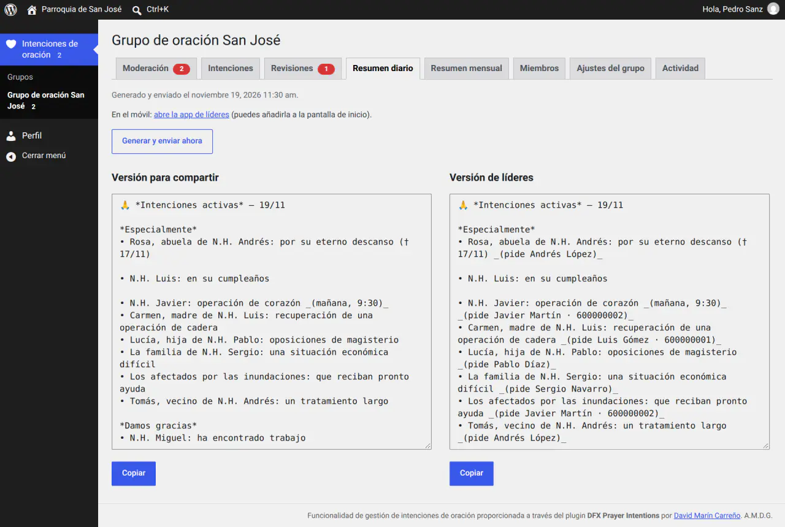

### Cuándo sale

- Por defecto, cada día a las 07:00 («Resumen diario a las»).
- Si se deja **vacío**, no sale solo: únicamente cuando alguien pulsa «Generar y enviar ahora», o lo pide una rutina al terminar su trabajo.
- «Cuando no hay novedades» decide entre enviar una versión breve o no enviar nada.

### El resumen mensual

La pestaña «Resumen mensual» tiene la lista mensual en sus dos versiones. **Nunca se envía sola**: se copia desde aquí o desde la app.

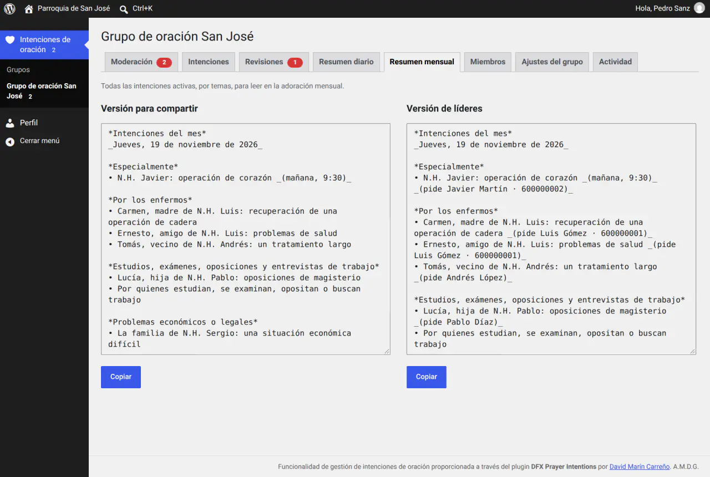

### Avisos de hora

Para los acontecimientos con hora, el plugin envía un aviso 15 minutos antes: «A las 8:30: … Unidos en oración.» Puede enviar un segundo aviso a la hora exacta.

Entre las 23:00 y las 07:00 (las horas de silencio, configurables) no sale ningún aviso. Esos acontecimientos aparecen en «Sin aviso de hora» del resumen de líderes. Si ningún resumen los recogió, sale un aviso adelantado justo antes de las horas de silencio. Así ningún acontecimiento se queda sin avisar.

### Canales

El panel siempre ofrece copiar y pegar en WhatsApp. En «Ajustes del grupo › Canales» se activan tres canales automáticos; cada uno elige si recibe el resumen diario, los avisos de hora y las peticiones nuevas.

| Canal | Qué se configura | Qué recibe |
| --- | --- | --- |
| Correo | Destinatarios; vacío = todos los líderes con correo, salvo las cuentas de servicio | Siempre la versión de líderes, con negritas y enlaces |
| Telegram | Token del bot e ID del chat | La versión para compartir o la de líderes (solo en un chat privado de líderes) |
| Webhook | URL y secreto de firma | JSON firmado con HMAC-SHA256, para Slack, Discord, n8n… |

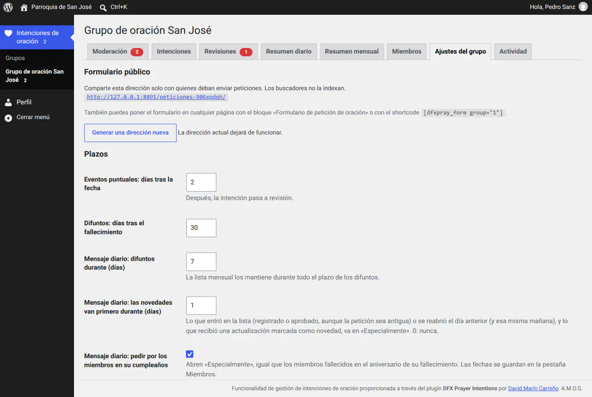

Por defecto solo el correo está activo, para el resumen y las peticiones nuevas.

«Probar los canales» envía un mensaje de prueba por cada uno. Lo que no llega queda en «Actividad › Envíos fallidos» con el motivo.

WhatsApp no tiene canal automático: su API oficial no puede publicar en grupos creados por particulares, y las vías no oficiales arriesgan que se bloquee el número.

## Los miembros del grupo

La pestaña «Miembros» guarda a los hermanos del grupo para nombrarlos bien y pedir por ellos en su cumpleaños, que abre «Especialmente» en el mensaje diario. Solo la ven los líderes.

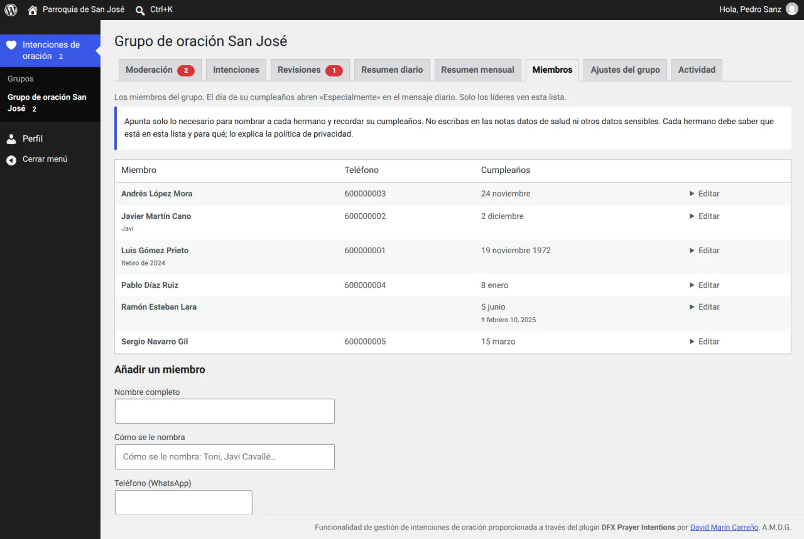

### Los datos de cada miembro

| Campo | Para qué sirve |
| --- | --- |
| «Nombre completo» | Obligatorio |
| «Cómo se le nombra» | Toni, Javi Cavallé… Vacío: la primera palabra del nombre |
| «Teléfono (WhatsApp)» | Para escribirle desde la app |
| «Cumpleaños» | Día y mes, y el año si se quiere. Quien nació un 29 de febrero lo celebra el 28 en los años no bisiestos |
| «Fecha de fallecimiento» | Deja de mencionársele en su cumpleaños y se pide por él cada año en el aniversario |
| «Notas» | Internas, por ejemplo «XI Retiro – Mesa 1» |

Apunta solo lo necesario para nombrar a cada hermano y recordar su cumpleaños. No escribas en las notas datos de salud ni otros datos sensibles.

Si dos miembros se nombrarían igual, el mensaje añade el primer apellido para distinguirlos.

«Editar» abre los campos de un miembro con «Guardar» y «Borrar». Cuidado: «Borrar» no pide confirmación. «Añadir un miembro», al final, crea uno nuevo.

La lista de miembros es distinta de la casilla «Es de nuestro grupo» de cada intención: esa casilla es la que decide si se pone el prefijo («N.H.») en el mensaje.

## Ajustes

«Ajustes globales» (solo administradores) fija los valores de todos los grupos. «Ajustes del grupo» los cambia para uno solo, y «Devolver este grupo a los ajustes globales» deshace esos cambios.

Al guardar «Ajustes del grupo» por primera vez, el grupo se queda con todos los valores de ese momento. Los cambios posteriores en «Ajustes globales» ya no le llegan hasta que se devuelva a los ajustes globales.

### Plazos

| Ajuste | Por defecto |
| --- | --- |
| «Eventos puntuales: días tras la fecha» | 2 |
| «Difuntos: días tras el fallecimiento» | 30 |
| «Cerrar los difuntos al cumplirse ese plazo» | Sí |
| «Situaciones prolongadas: revisar cada (días)» | 30 |
| «Acción de gracias: días» | 7 |
| «Cerrar las acciones de gracias al cumplirse su plazo» | Sí |
| «“Sigue vigente”: días hasta la próxima revisión» | 30 |
| «Mensaje diario: difuntos durante (días)» | 7 |
| «Mensaje diario: las novedades van primero durante (días)» | 1 |
| «Mensaje diario: acciones de gracias durante (días)» | 1 |
| «Mensaje diario: pedir por los miembros en su cumpleaños» | Sí |
| «Lista mensual: acciones de gracias de los últimos (días)» | 30 |

### Textos

| Ajuste | Por defecto |
| --- | --- |
| «Mensaje tras enviar el formulario» | «Gracias. Hemos recibido tu petición y rezaremos por ella.» |
| «Encabezado del índice» | «🙏 *Intenciones activas* – {date}» |
| «Encabezado de la lista mensual» | «*Intenciones del mes*» y la fecha larga |
| «Pie del índice» | Vacío |
| «Formato del índice» | «Por tipo» |
| «Prefijo para los miembros del grupo» | Vacío (por ejemplo, «N.H.») |
| «Emojis en las secciones del índice» | No |
| «Incluir los comentarios internos recientes en el resumen de líderes» | No |

### Horarios

| Ajuste | Por defecto |
| --- | --- |
| «Resumen diario a las» | 07:00 (vacío: solo cuando se envía a mano) |
| «Cuando no hay novedades» | «Enviar una versión breve» |
| «Avisos de hora: minutos antes» | 15 |
| «Segundo aviso a la hora exacta» | No |
| «Horario de silencio desde» / «hasta» | 23:00 / 07:00 |

### Datos personales en los mensajes

| Ajuste | Por defecto |
| --- | --- |
| «Incluir el texto completo de las peticiones nuevas en el aviso por correo» | Sí |
| «Incluir los teléfonos de quienes piden en la versión de líderes» | Sí |

### Solo en «Ajustes globales»

| Ajuste | Por defecto |
| --- | --- |
| «Prestador del servicio (encargado del tratamiento)», NIF, dirección y correo | Vacío: el propio sitio es el responsable |
| «Subencargados» | Vacío: los proveedores de alojamiento y correo del sitio |
| «Responsable del tratamiento por defecto» y su contacto | El nombre del sitio |
| «Edad mínima para enviar peticiones» | 14 |
| «Borrar las intenciones cerradas y descartadas a los (días)» | 90 |
| «Prefijo de país de los teléfonos» | 34 |
| «Comienzo de las direcciones del formulario» | «peticiones» (también da la dirección de la app) |
| «Máximo de peticiones por hora desde una misma conexión» | 5 |
| Claves de Cloudflare Turnstile | Vacías: desactivado |
| «Borrar todos los datos al desinstalar el plugin» | Sí |
| «Acceso al panel» | Roles que pueden dirigir grupos |

Los canales (correo, Telegram, webhook) se configuran solo en cada grupo.

## La app para responsables

La app lleva el panel al móvil: el mensaje de hoy listo para compartir, las intenciones con su seguimiento, a quién preguntar, los cumpleaños y un formulario rápido para añadir. Funciona también sin conexión.

### Instalarla

La dirección es la del sitio seguida de `/peticiones-app/` (en un sitio en español; cambia si se cambia «Comienzo de las direcciones del formulario»). Se entra con el mismo usuario y contraseña de WordPress, y la app recuerda la sesión.

- **Android (Chrome)**: menú ⋮ › «Instalar aplicación» o «Añadir a pantalla de inicio».
- **iPhone (Safari)**: botón Compartir › «Añadir a pantalla de inicio».

Queda como un icono más, llamado «Oración», que se abre a pantalla completa. Desde la pestaña «Resumen diario» del panel hay un enlace directo.

Cuando abres el panel en el móvil o la tableta, arriba de cada pantalla aparece «Instala la app en tu móvil:» con la dirección de la app, el botón «Copiar enlace» y, en «Cómo instalarla», estos dos pasos; el menú «Intenciones de oración» tiene además la entrada «Instalar la app». En el ordenador no aparece nada de esto.

Si abres la app en el móvil sin haberla instalado, arriba de «Hoy» aparece el botón «Instalar la app» (en Android con Chrome) o la indicación de pulsar Compartir y luego «Añadir a pantalla de inicio» (en iPhone y iPad). Desaparece en cuanto la app está instalada.

### Las pantallas

En la barra de abajo hay seis botones. Si diriges varios grupos, arriba hay un selector para elegir el grupo, y la app recuerda el último.

| Pantalla | Qué hay |
| --- | --- |
| «Hoy» | El mensaje del día («Diario») o la «Lista mensual», con «Compartir» (abre WhatsApp u otra app) y «Copiar». En el diario, «Marcar como enviado al grupo» para cuando ya lo hayas compartido (con «Deshacer») |
| «Intenciones» | La lista con buscador y filtro: «Vigentes», «Por revisar» o «Cerrada». Las urgentes van resaltadas |
| «Consultar» | A quién preguntar cómo sigue, agrupado por quien pidió, con un botón de WhatsApp que ya lleva escrita la pregunta |
| «Miembros» | Los cumpleaños y aniversarios por meses, con el mes actual abierto y un botón para escribir por WhatsApp |
| «Moderación» | Las peticiones por moderar y las intenciones por revisar |
| «Añadir» | La ficha de cinco pasos del panel, con «Así saldrá»: la línea tal como quedará en el mensaje |

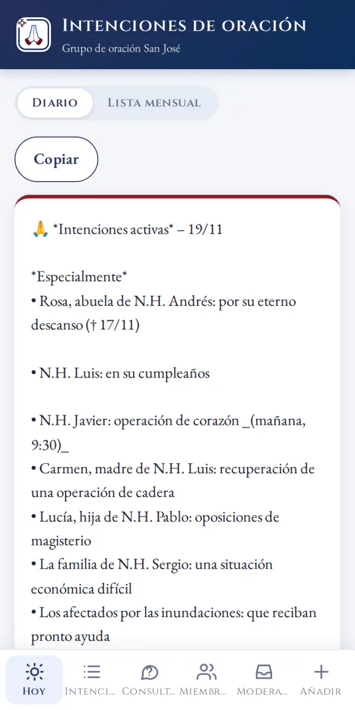
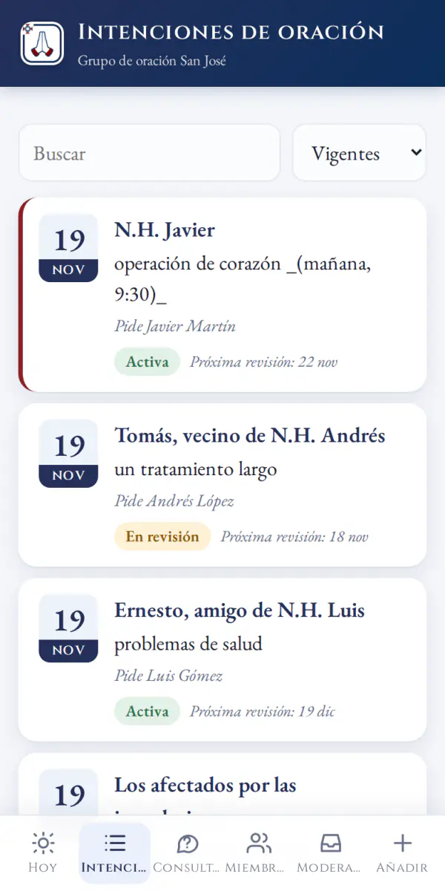
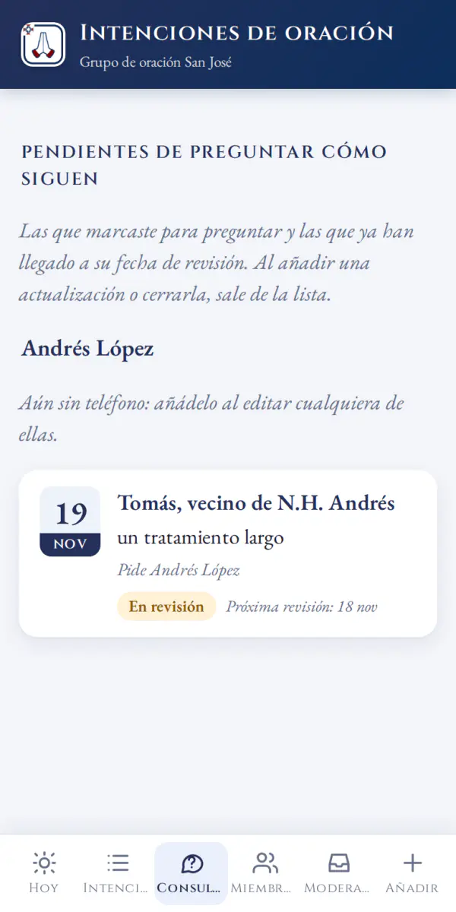
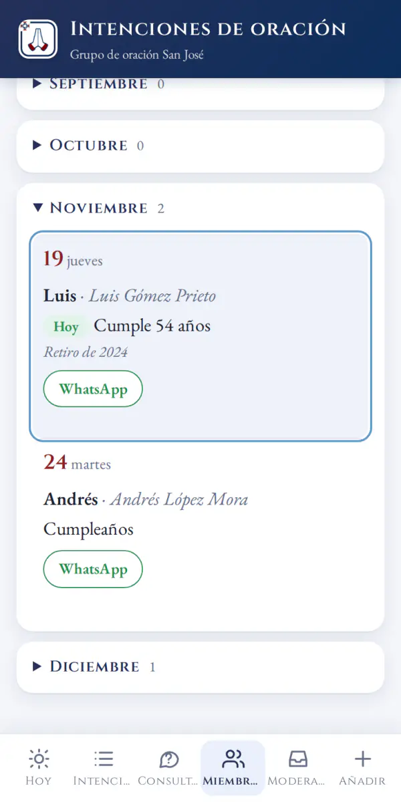
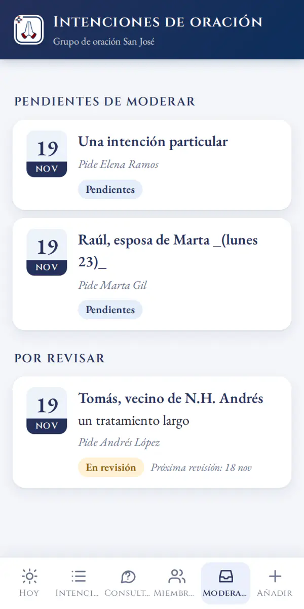
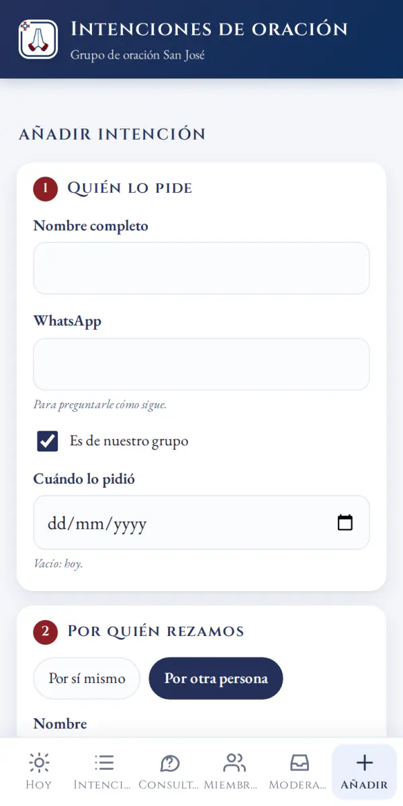

La pregunta de «Consultar» sale como «Hola, Luis. ¿Cómo sigue Carmen (operación de cadera)?». Si son varias, se pregunta por todas a la vez. Al añadir una actualización o cerrar la intención, sale de la lista.

### La ficha de una intención en la app

Al tocar una intención se ve su línea, quién la pide, el «Texto completo» (plegado) y sus actualizaciones. Desde ahí se puede:

- **si está pendiente**: escribir el resumen y «Aprobar», o «Descartar» (pide un segundo toque y la descarta como spam);
- **si está vigente**: añadir una actualización, «Sigue vigente», cambiar la prioridad, posponer la revisión o cerrarla (con acción de gracias si se atendió);
- **si está cerrada**: «Reabrir»;
- y siempre «Editar» y «Preguntar por WhatsApp cómo sigue».

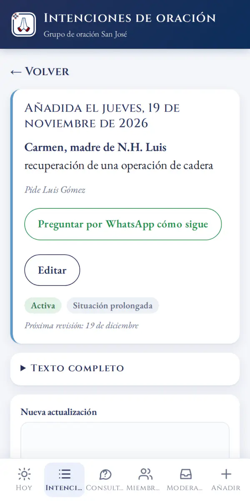

Quedan solo en el panel los comentarios internos, fusionar, trasladar, el acuse de recibo, editar miembros, los ajustes y el resumen de líderes.

### Sin conexión

- La app guarda en el móvil el último mensaje y las listas, solo con las líneas resumidas, nunca el texto completo. Sin cobertura los muestra con el aviso «Sin conexión: se muestran los últimos datos guardados en este dispositivo».
- Lo que hagas sin conexión queda en cola («Pendientes de enviar: N») y se envía en cuanto vuelve la red.
- La ficha de una intención y «Miembros» necesitan conexión.
- Si una intención añadida o editada sin conexión está esperando en la cola, lo escrito, incluido «Lo que nos contó», se guarda en el móvil hasta que se envía.

La sesión de la app dura alrededor de un día. Después aparece «La sesión ha caducado. Vuelve a cargar la app.»: basta con recargarla.

## Rutinas automáticas

Una rutina es un programa del propio líder que mantiene la lista al día sin abrir el panel: por ejemplo, uno que lee las novedades del grupo cada mañana, las registra y envía el resumen al terminar. Entra por una única ruta de la API REST con una contraseña de aplicación, y tiene exactamente los mismos permisos que su usuario en el panel.

### Preparar una rutina

1. **Crea un usuario propio para la rutina**, con el rol «Líder de oración», y márcalo como líder solo de los grupos que va a llevar.
2. **Márcalo como cuenta de servicio**: un administrador, en el perfil del usuario, sección «DFX Prayer Intentions», activa «Esta cuenta solo la usa una rutina».
3. **Crea una contraseña de aplicación** en ese mismo perfil (sección «Contraseñas de aplicación» de WordPress). Guárdala donde solo la lea el programa, nunca en el texto de la rutina.

Si un plugin de seguridad desactiva las contraseñas de aplicación (Wordfence lo hace con «Disable WordPress application passwords»), la ruta responderá siempre 401 hasta que se permitan.

### Qué cambia con una cuenta de servicio

- Conserva los permisos de los grupos que dirige, y nada más.
- No recibe correos del plugin.
- Sus contraseñas de aplicación solo abren la ruta del plugin: el resto de la API de WordPress responde 403, y XML-RPC las rechaza.
- En la lista de líderes aparece con «· cuenta de servicio».

### La ruta

`POST /wp-json/dfxpray/v1/<operación>` (o `/?rest_route=/dfxpray/v1/<operación>`), con autenticación básica (usuario y contraseña de aplicación) y los datos en JSON. Responde `{ok, code, message, id, data}`. Sin contraseña de aplicación, 401; fuera de los grupos del usuario, 403.

| Operación | Hace |
| --- | --- |
| `bootstrap` | Los grupos del usuario |
| `list` | Las intenciones de un grupo, por estado o buscando texto |
| `get` | Una intención con su línea y sus actualizaciones |
| `index` | El mensaje para compartir, diario o mensual |
| `digest` | El resumen de hoy y si ya se envió |
| `members` | Los miembros del grupo |
| `preview` | La línea que saldría, sin guardar nada |
| `save_intention` | Crea o edita una intención |
| `add_update` | Añade una actualización |
| `close`, `reopen`, `keep_active`, `postpone`, `set_priority` | Las acciones rápidas del panel |
| `approve`, `discard` | Moderar |
| `send_digest_now` | Envía el resumen diario, como «Generar y enviar ahora» |
| `save_member` | Crea (`member_id` 0 y `group_id`) o edita (`member_id`) un miembro del grupo; solo cambian los campos que se envían en `member` (`name`, `called`, `phone`, `birth_day`…). Borrar miembros sigue siendo solo cosa del panel |

Los campos son los mismos que los de las fichas del panel. Para que el resumen salga justo cuando la rutina termina, deja vacío «Resumen diario a las» y que la rutina llame a `send_digest_now` al final.

## Protección de datos

Las peticiones de oración suelen llevar datos de salud y de creencias de terceros, así que el plugin está hecho para guardar lo mínimo, enseñarlo solo a quien debe y permitir encontrarlo y borrarlo. Esto no es asesoramiento legal: revisa tu caso con un profesional.

### Quién responde de los datos

- **Cada grupo tiene su responsable del tratamiento** (por ejemplo, la parroquia), con su contacto y, si quiere, su propia política de privacidad. Lo anota el administrador en la ficha del grupo.
- **Si el sitio lo presta otra persona u organización**, esta figura en «Ajustes globales» como «Prestador del servicio», que actúa como encargado del tratamiento de cada grupo. Cada grupo acepta su encargo de tratamiento, cuyo texto se copia desde la ficha del grupo, y se anota la fecha.
- **El formulario informa** del responsable, el prestador, la finalidad, la base legal (consentimiento explícito), los destinatarios y los derechos, con enlace a la política de privacidad.

### Lo que el plugin hace por diseño

- Ninguna petición se guarda sin las tres casillas del formulario.
- El texto completo nunca se publica: solo lo leen los líderes, y solo viaja por correo.
- La discreción solo puede endurecerse, nunca relajarse.
- Las intenciones viven en tablas propias, fuera de entradas, feeds, búsquedas y mapas del sitio.
- Las cerradas y descartadas se borran a los 90 días, con sus actualizaciones, comentarios e historial. La IP de quien envía el formulario solo se guarda como huella irreversible (hash) durante una hora, para limitar el abuso.
- La app no guarda en el móvil el texto completo de las peticiones.

### Solicitudes de las personas

En «Ajustes globales › Solicitudes sobre datos personales» se busca por email o por teléfono, en cualquier formato (con o sin espacios, +34 o 0034). El resultado reúne todo lo que el plugin guarda de esa persona, como solicitante o como miembro, para copiarlo y entregárselo. «Borrar todo lo encontrado» lo elimina; no se puede deshacer.

El plugin también se integra con las herramientas de WordPress *Herramientas › Exportar datos personales* y *Borrar datos personales*, que buscan solo por email.

### Política de privacidad

El plugin propone un texto para la guía de política de privacidad de WordPress. Explica quién trata los datos, cuáles y para qué, quién los ve (incluida una posible rutina del líder), los servicios opcionales, los plazos, los derechos de las personas por las que se reza, los miembros, los menores y la reclamación ante la AEPD.

Cada líder ve, al entrar en su grupo, el aviso de confidencialidad, hasta que pulsa «Entendido».

## Preguntas frecuentes y problemas

**El resumen o los avisos llegan tarde, o no llegan.** WordPress solo ejecuta sus tareas cuando alguien visita la web. Configura un cron del sistema que llame a `wp-cron.php` cada cinco minutos. Comprueba también que «Resumen diario a las» no esté vacío, y que el aviso no caiga en las horas de silencio.

**No sale «N.H.» delante de los hermanos.** «Prefijo para los miembros del grupo» viene vacío: escríbelo en los ajustes. Y marca «Es de nuestro grupo» en la intención.

**No salen «Especialmente», los cumpleaños, la línea de salud ni «Actualidad».** Son del formato «Propuestas de oración»; el formato por defecto es «Por tipo». Cámbialo en «Formato del índice».

**Cambié un ajuste global y un grupo no lo nota.** Ese grupo guardó sus propios ajustes. Usa «Devolver este grupo a los ajustes globales», o cambia el valor en «Ajustes del grupo».

**El resumen mensual no llega por correo.** No se envía nunca solo: cópialo de la pestaña «Resumen mensual» o de «Hoy › Lista mensual» en la app.

**«El formulario ha caducado. Vuelve a enviarlo.»** El formulario lleva un código de seguridad que caduca. Si pasa a menudo, la página está en una caché: exclúyela a mano.

**«Demasiadas peticiones desde tu conexión.»** Se ha llegado a 5 peticiones por hora desde la misma red, algo que puede pasar con la wifi de una parroquia. Sube el límite en «Ajustes globales».

**El formulario dice «Este formulario no está disponible» o la dirección da error 404.** El grupo está archivado, o se generó una dirección nueva y la antigua ya no vale.

**«Escribe el resumen para el índice antes de activar la intención.»** Toda intención activa necesita resumen, de hasta 100 caracteres.

**«Con discreción “nombre de pila”, la descripción no puede incluir apellidos.»** Quita los apellidos de la descripción, o usa «Cómo le llamamos».

**«La sesión ha caducado. Vuelve a cargar la app.»** Recarga la app; si pide usuario y contraseña, vuelve a entrar.

**Un correo, un Telegram o un webhook no llega.** Usa «Probar los canales» y mira el motivo en «Actividad › Envíos fallidos». Recuerda que las cuentas de servicio no reciben correos.

**Los enlaces de WhatsApp no abren el chat correcto.** Revisa «Prefijo de país de los teléfonos» (34 por defecto) y el número guardado.

**¿Puede publicar solo en nuestro grupo de WhatsApp?** No. Se copia y se pega, o se comparte desde la app.

**Una rutina recibe 401.** La contraseña de aplicación no es válida, se revocó, o un plugin de seguridad desactiva las contraseñas de aplicación.

**Voy a desinstalar el plugin.** Por defecto se borran todos los datos. Si no quieres perderlos, desactiva antes «Borrar todos los datos al desinstalar el plugin» en «Ajustes globales».
